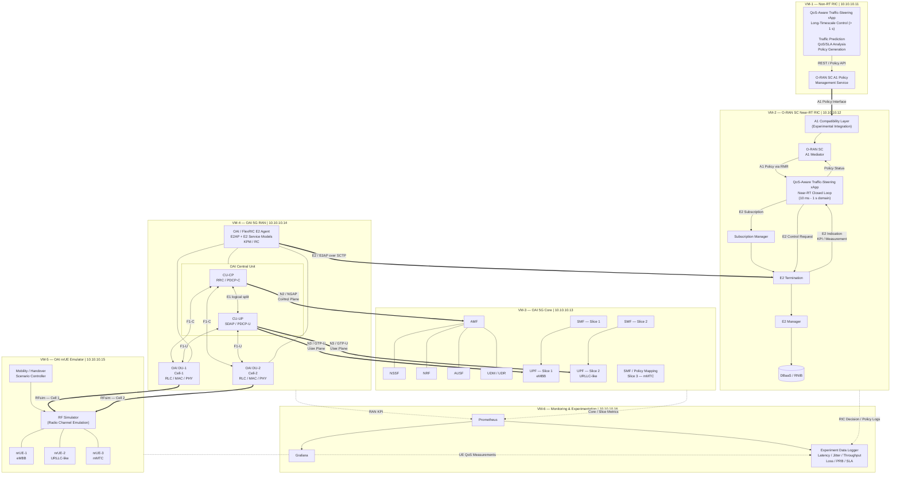
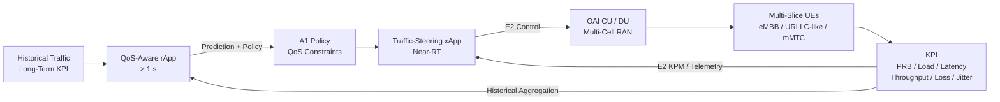
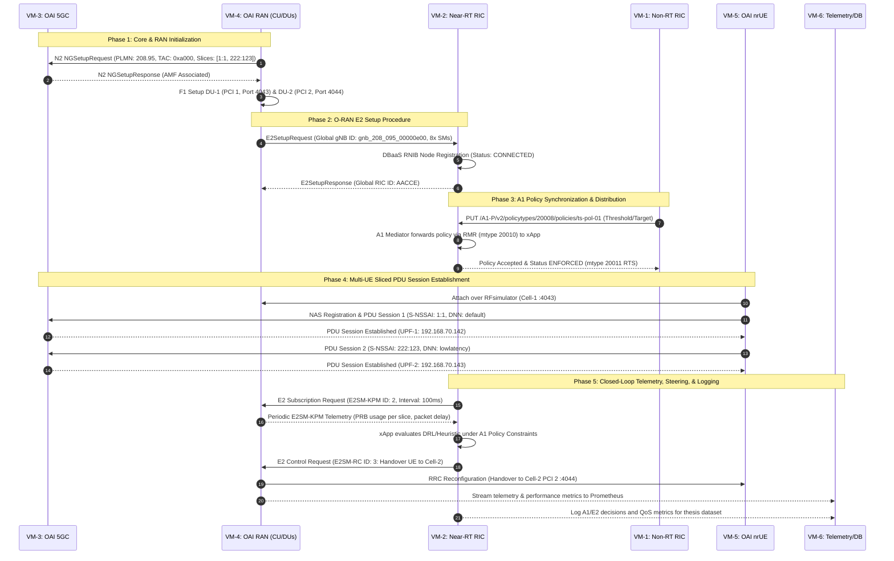

# Multi-Timescale QoS-Aware Traffic Steering in Multi-Slice O-RAN

> **Thesis Research Title:**  
> *Development of a Multi-Timescale QoS-Aware Traffic Steering Mechanism for rApp and xApp Coordination in Multi-Slice O-RAN*

This repository contains the architecture, configuration, deployment procedures, and integration artifacts for a **software-only, multi-timescale O-RAN experimental platform**. The platform enables empirical investigation into the hierarchical coordination between a Non-RT RIC rApp and a Near-RT RIC xApp to achieve QoS-aware traffic steering across multiple 5G network slices.

The platform is deployed entirely on virtual machines connected over a dedicated private network (`10.10.10.0/24`), requiring **no physical SDR hardware or commercial UEs**, ensuring complete reproducibility for experimental academic research.

---

## 1. System Architecture Overview

The experimental testbed implements a fully disaggregated, standards-compliant O-RAN and 3GPP Release 16/17 network divided across 6 dedicated virtual machines:



---

## 2. Multi-Timescale Control & Proposed Research Mechanism

The fundamental contribution of this thesis is the **coordination mechanism between two asynchronous control loops** operating at different timescales to resolve the trade-off between long-term QoS guarantee and immediate radio resource optimization:



### The Proposed Coordination Mechanism
1. **Preventing xApp Myopia:** A standalone xApp optimizing purely on instantaneous radio channel states (CQI/RSRP) often causes ping-pong handovers or starves lower-priority slices. The rApp introduces **stability thresholds and slice QoS weights** via A1 to enforce global optimality over long horizons.
2. **Conflict-Free Hierarchical Decision Making:** The rApp sets the *policy space* (e.g., maximum allowed handover frequency, minimum guaranteed PRB ratio), while the xApp selects the *instantaneous actuation* within that boundary.
3. **Closed-Loop Feedback:** The xApp returns A1 policy enforcement status (`ENFORCED` / `NOT_ENFORCED`) back to the rApp, completing the outer multi-timescale control loop.

---

## 3. Expected End-to-End Communication Lifecycle

The complete operational flow of the experimental testbed executes in five orchestrated phases:



---

## 4. Virtual Machine Specifications & Topology

All virtual machines run on Ubuntu 22.04 LTS interconnected via static IP assignments:

| VM | Hostname | IP Address | vCPU | RAM | Disk | Key Assigned Services |
|---|---|---|:---:|:---:|:---:|---|
| **VM-1** | `nonrt-ric` | `10.10.10.11` | 4 | 8 GB | 30 GB | Non-RT RIC, A1 PMS v2.6.0, Custom QoS rApp |
| **VM-2** | `near-rt-ric` | `10.10.10.12` | 6 | 12 GB | 40 GB | Minimal Near-RT RIC, A1 Mediator, xApp, E2Term, E2Mgr, DBaaS Redis 5.0.9 |
| **VM-3** | `oai-5gc` | `10.10.10.13` | 4 | 8 GB | 30 GB | OAI 5GC v2.1.0 Multi-Slice (AMF, SMF-1/2, UPF-1/2, NRF, UDM, MySQL) |
| **VM-4** | `oai-ran` | `10.10.10.14` | 8 | 16 GB | 50 GB | OAI 5G RAN (CU + DU-1 + DU-2 + FlexRIC E2 Agent + RFsim :4043/:4044) |
| **VM-5** | `ue-emulator` | `10.10.10.15` | 4 | 8 GB | 30 GB | OAI nrUE Multi-Instance Emulator (rfsim client) |
| **VM-6** | `monitoring-data` | `10.10.10.16` | 4 | 8 GB | 40 GB | Prometheus TSDB, Grafana Dashboards, Telemetry Collector |

---

## 5. Network Slicing & Cellular Radio Profile

| Parameter | Slice 1 (Throughput) | Slice 2 (Low-Latency) | Standardization & Compliance |
|---|---|---|---|
| **Service Role** | High Throughput / Bulk Data (eMBB) | Ultra-Reliable Low-Latency / Mission-Critical | 3GPP TS 23.501 Clause 5.15 |
| **SST** | `1` (Standard eMBB) | `222` (`0xDE`, Operator-Specific) | 3GPP TS 23.501 Table 5.15.2.2-1 |
| **SD** | `0x000001` (decimal `1`) | `0x00007B` (decimal `123`) | 24-bit Slice Differentiator |
| **Default DNN** | `default` | `lowlatency` | Data Network Name mapping |
| **UPF Endpoint** | `192.168.70.142:2152/UDP` | `192.168.70.143:2152/UDP` | Multi-UPF routed via Docker bridge |
| **PLMN Identity** | `MCC = 208, MNC = 95` | `MCC = 208, MNC = 95` | 3GPP TS 38.413 / TS 23.003 |
| **Tracking Area** | `TAC = 0xa000` (`40960`) | `TAC = 0xa000` (`40960`) | 3GPP TS 24.501 |
| **Cell Allocation** | Cell-1 (DU-1, PCI 1, rfsim :4043) | Cell-2 (DU-2, PCI 2, rfsim :4044) | 3GPP TS 38.211 (PCI 0–1007) |

---

## 6. Implementation & Validation Status

| Milestone / Component | Target VM | Current Status | Verification Evidence / Reference |
|---|---|:---:|---|
| **VM-1: Non-RT RIC & A1 PMS** | VM-1 | ✅ Complete | Healthcheck `200 OK`, live OpenAPI schema exposed on port 8081. |
| **VM-2: Near-RT RIC Platform** | VM-2 | ✅ Complete | Minimal O-RAN SC (E2Term, E2Mgr, DBaaS, SubMgr) healthy. |
| **A1 Interface Integration** | VM-1 $\leftrightarrow$ VM-2 | ✅ Complete | A1 PMS $\leftrightarrow$ A1 Shim $\leftrightarrow$ A1 Mediator $\leftrightarrow$ xApp validated. |
| **VM-3: OAI 5G Core Multi-Slice** | VM-3 | ✅ Complete | 12 containers running; dual UPFs active; N2 exposed on port 38412. |
| **VM-4: OAI RAN Split CU/DU** | VM-4 | ✅ Complete | CU and Dual DUs compiled; F1-C/F1-U active; Cell 1 & 2 in service. |
| **O-RAN E2 Interface Integration** | VM-4 $\leftrightarrow$ VM-2 | ✅ Complete | Node `gnb_208_095_00000e00` connected; 8 Service Models registered. |
| **VM-5: OAI nrUE Multi-UE** | VM-5 | ⏳ Next Phase | Dual-slice multi-UE connection via RFsimulator TCP sockets. |
| **F1 Handover Execution** | VM-4 / VM-5 | ⏳ Next Phase | Inter-cell handover between DU-1 (:4043) and DU-2 (:4044). |
| **Coordinated rApp + xApp Steering** | VM-1 / VM-2 | ⏳ Planned | Thesis evaluation: QoS-aware DRL traffic steering mechanism. |
| **Telemetry & Experiment Pipeline** | VM-6 | ⏳ Planned | Automated logging of throughput, latency, loss, and handover signaling. |

---

## 7. Experimental Baselines for Thesis Evaluation

To validate the proposed multi-timescale mechanism, the research evaluates four comparative baselines:

1. **Baseline 1 — Conventional 3GPP RAN Handover (No RIC):** Standard RRC A3-event handover based solely on RSRP signal strength thresholds without slice or QoS awareness.
2. **Baseline 2 — Static Network Slicing (No Dynamic Steering):** Slices have rigid, static PRB reservations with no inter-cell traffic re-routing.
3. **Baseline 3 — Standalone xApp Steering (Single-Timescale):** Near-RT xApp steers traffic based on short-term channel states, but operates without rApp long-timescale policy guidance.
4. **Proposed System — Multi-Timescale Coordinated rApp + xApp Steering:** rApp provides adaptive QoS boundaries over A1, while xApp executes near-real-time steering over E2 to eliminate ping-pong events and protect high-priority slice SLAs.

---

## 8. Repository Structure & Documentation Index

```text
Thesis/
├── README.md                          # Repository overview, architecture, and research framework
├── docs/
│   ├── architecture.md                # In-depth architectural design, layers, and interfaces
│   ├── vm1-nonrt-ric.md               # Step-by-step deployment guide for VM-1 (Non-RT RIC)
│   ├── vm2-nearrt-ric.md               # Step-by-step deployment guide for VM-2 (Near-RT RIC)
│   ├── vm3-oai-5gc.md                 # Deployment & slicing guide for VM-3 (OAI 5GC)
│   ├── vm4-oai-ran.md                 # Build & deployment guide for VM-4 (OAI Split RAN)
│   ├── a1-integration.md              # Complete A1 integration guide (VM-1 to VM-2)
│   ├── e2-integration.md              # Complete E2 integration guide (VM-4 to VM-2)
│   └── troubleshooting.md             # Solutions for 29+ validated operational failure modes
└── configs/                           # Deployment manifests and configuration files
```

### Direct Links to Detailed Guides:
- **Architecture Specification:** [docs/architecture.md](docs/architecture.md)
- **Node Installation Guides:**
  - [VM-1: Non-RT RIC Installation Guide](docs/vm1-nonrt-ric.md)
  - [VM-2: Near-RT RIC Installation Guide](docs/vm2-nearrt-ric.md)
  - [VM-3: OAI 5G Core Installation Guide](docs/vm3-oai-5gc.md)
  - [VM-4: OAI RAN CU/DU Installation Guide](docs/vm4-oai-ran.md)
- **Interface Integration Guides:**
  - [A1 Integration Guide (Non-RT to Near-RT)](docs/a1-integration.md)
  - [E2 Integration Guide (RAN to Near-RT)](docs/e2-integration.md)
- **Troubleshooting Manual:** [docs/troubleshooting.md](docs/troubleshooting.md)

---

## 9. References & Standards Compliance
- **O-RAN WG1:** O-RAN Architecture Description v07.00
- **O-RAN WG2:** A1 Interface: General Aspects and Principles v03.01
- **O-RAN WG3:** E2 Application Protocol (E2AP) v02.03
- **3GPP TS 23.501:** System Architecture for the 5G System (Release 17)
- **3GPP TS 38.413:** NG-RAN; NG Application Protocol (NGAP)
- **3GPP TS 38.470 / TS 38.473:** NG-RAN; F1 Application Protocol (F1AP)
- **OpenAirInterface:** https://gitlab.eurecom.fr/oai/openairinterface5g
- **O-RAN Software Community:** https://wiki.o-ran-sc.org/
