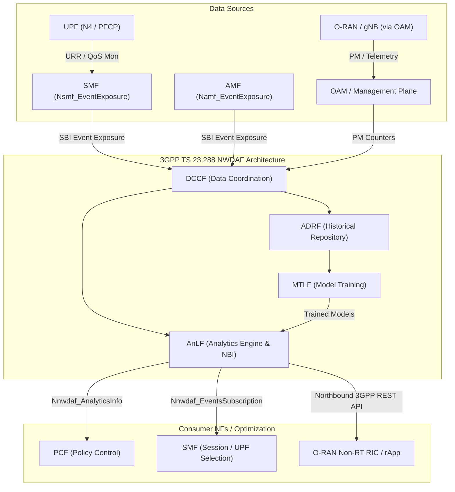

# 3GPP NWDAF Technical Specification, Integration Guidelines, and Testbed Scope

**Reference Standards:** 3GPP TS 23.288, TS 29.520, TS 28.552 (Release 19 / Release 17 Alignment)  
**Supplemental Frameworks:** ETSI, O-RAN Alliance, GSMA, ITU-T (Y.3172 / Y.3174), and UU PDP No. 27/2022  
**Target Environment:** Multi-Slice 5G Core (VM-3), O-RAN Split RAN (VM-4), nrUE (VM-5), and Monitoring/RIC Host (VM-6)  
**System Role:** Authoritative Architectural Manual & Testbed Delimitation Document

---

## 1. Executive Overview

The **Network Data Analytics Function (NWDAF)** is a standardized 3GPP Network Function (NF) residing within the 5G Service-Based Architecture (SBA). Its primary role is to collect operational telemetry across the 5G System (5GS), process raw network events into descriptive statistics or predictive machine learning (ML) models, and expose standardized analytics to other Network Functions (e.g., PCF, SMF, AMF, NSSF) and management systems (OAM, RIC) to enable automated, closed-loop network optimization.

Within a 5G Standalone (5GC) deployment, NWDAF provides analytical insights into:
* Network slice and NF resource utilization.
* User Equipment (UE) mobility, dispersion, and communication dynamics.
* Quality of Service (QoS) sustainability and service experience degradation.
* User-plane and transport congestion.
* Network anomaly detection and signaling storm prediction.

> [!IMPORTANT]
> **Fundamental Design Principle:**  
> NWDAF is **not** an exhaustive, monolithic monitoring agent that automatically polls every metric and counter from all 5G network components. The telemetry accessible to an NWDAF instance is strictly constrained by:
> 1. Available standardized Network Function Services and Exposure APIs.
> 2. The specific **Analytics IDs** requested by consumers.
> 3. Supported 3GPP Release features (e.g., Release 15/16 baseline vs. Release 17/18/19 enhancements).
> 4. Physical deployment architecture and vendor-specific implementation limits.

---

## 2. Authoritative Specification Hierarchy

The technical foundation of NWDAF is governed by three primary, complementary 3GPP specifications published through ETSI:

```text
┌────────────────────────────────────────────────────────────────────────┐
│                   3GPP TS 23.288 (Stage 2)                              │
│   Architecture Enhancements for 5GS to Support Network Data Analytics  │
│   • Functional entities (AnLF, MTLF, DCCF, ADRF, MFAF)                 │
│   • Data collection mechanisms, input NF services, & Analytics IDs     │
└──────────────────┬─────────────────────────────────┬───────────────────┘
                   │                                 │
                   ▼                                 ▼
┌──────────────────────────────────────┐  ┌──────────────────────────────┐
│       3GPP TS 29.520 (Stage 3)       │  │   3GPP TS 28.552 (OAM / PM)   │
│   Network Data Analytics Services    │  │   5G Performance Measurements │
│   • OpenAPI REST specifications      │  │   • Standardized PM counters  │
│   • Nnwdaf_AnalyticsInfo (HTTP GET)  │  │   • AMF, SMF, UPF, & gNB      │
│   • Nnwdaf_EventsSubscription (POST) │  │     performance indicators    │
│   • JSON schemas & error definitions │  │   • Management plane inputs   │
└──────────────────────────────────────┘  └──────────────────────────────┘
```

### 2.1 Specification Role Matrix

| Specification | Primary Scope | Core Clauses & References | Critical Architectural Question Answered |
|---|---|---|---|
| **3GPP TS 23.288**<br>*(ETSI TS 123 288)* | System Architecture & Analytics Capabilities | Clauses 4, 5, 6.1–6.25, and Clause 7 (Table 7.1-2) | *How does NWDAF coordinate data collection, what inputs are required, and what analytics are generated?* |
| **3GPP TS 29.520**<br>*(ETSI TS 129 520)* | Protocol & API Implementation (Stage 3) | Clauses 4, 5.1, 5.2, and Annex A (OpenAPI Schemas) | *How do consumer NFs request, subscribe, and receive analytics payloads over HTTP/2 REST APIs?* |
| **3GPP TS 28.552**<br>*(ETSI TS 128 552)* | 5G Performance Measurements & PM Counters | Clauses 5.1–5.18 (gNB and 5GC NF counters) | *What physical performance counters and metrics are standardized across AMF, SMF, UPF, and RAN?* |

---

## 3. NWDAF Architecture & Operational Workflow

### 3.1 Logical Functions Decomposition

In advanced 3GPP specifications (TS 23.288 Clauses 4–5), NWDAF functionality is decomposed into discrete logical functions:

* **AnLF (Analytics Logical Function):**  
  Responsible for computing descriptive statistics, ingesting historical telemetry, running inference against trained models, and serving analytics to consumers via Service-Based Interfaces (SBI).
* **MTLF (Model Training Logical Function):**  
  Responsible for training, validating, and updating machine learning models based on historical datasets, and exposing trained model artifacts to the AnLF.
* **DCCF (Data Collection Coordination Function):**  
  Coordinates multi-source data collection across NFs and OAM, preventing redundant subscriptions and duplicate network queries.
* **ADRF (Analytics Data Repository Function):**  
  Serves as the persistent storage layer for historical training datasets, raw telemetry records, and trained ML models.
* **MFAF (Messaging Framework Adaptation Function):**  
  Translates and adapts high-volume telemetry streams across messaging brokers (e.g., Kafka, AMQP) into standardized 3GPP notifications.



### 3.2 Standard Operational Workflow

1. **Analytics Request / Subscription:**  
   A consumer (e.g., PCF, SMF, or Non-RT RIC) issues a request or establishes an event subscription specifying a target `Analytics ID`, target UE identifier (`tgt-ue`), network slice (`s-nssai`), DNN, and time window (`ana-req`).
2. **NF Discovery & Data Source Identification:**  
   NWDAF identifies relevant data producers by querying the Network Repository Function (NRF) for registered NF instances (AMF, SMF, UDM).
3. **Data Ingestion:**  
   NWDAF initiates event subscriptions via NF Service-Based Interfaces (Channel E) or requests performance management counters via OAM interfaces (Channel O).
4. **Data Normalization & Correlation:**  
   Raw events from disparate NFs are temporally and contextually aligned using common dimension keys (Timestamp, SUPI, S-NSSAI, DNN, Cell ID/TAI, QFI).
5. **Analytics Inference / Calculation:**  
   The AnLF computes statistical aggregations or executes model inference using weights provided by the MTLF.
6. **Payload Exposure:**  
   The resulting analytics payload is delivered to the consumer either synchronously (Request/Response) or asynchronously (Subscribe/Notify).
7. **Closed-Loop Action:**  
   The consumer NF consumes the analytics to execute network actions (e.g., PCF updates QoS parameters, SMF reselects an optimal UPF, or RIC triggers traffic steering).

---

## 4. Standardized Analytics Capabilities (TS 23.288 Rel-19)

The table below catalogs standardized Analytics IDs specified in 3GPP TS 23.288 Table 7.1-2, classified into **Descriptive**, **Predictive**, and **Decision Support** capabilities:

| Analytics Category | Standard Analytics ID | Output Semantics & Analytical Scope | Output Classification |
|---|---|---|---|
| **Load & Capacity** | `SLICE_LOAD_LEVEL` | Reports current and predicted load level for a target S-NSSAI based on active sessions and provisioned limits. | Descriptive / Predictive |
| | `NF_LOAD` | Reports resource utilization (CPU, memory, storage) and traffic load of specific NF instances. | Descriptive / Predictive |
| | `NETWORK_PERFORMANCE` | Aggregated network health, session establishment success ratios, and failure distributions. | Descriptive / Predictive |
| **User Mobility** | `UE_MOBILITY` | Historical trajectories, duration of stay within target cells/TAIs, and predicted future locations. | Descriptive / Predictive |
| | `UE_DISPERSION` | Density, dispersion area, and spatial concentration of specific UE groups. | Descriptive |
| | `MOVEMENT_BEHAVIOUR` | Velocity, travel direction, and movement pattern classification. | Predictive |
| | `RELATIVE_PROXIMITY` | Proximity detection and co-location probability between multiple UEs. | Predictive |
| **Traffic Behaviour** | `UE_COMMUNICATION` | Cumulative uplink/downlink volume, communication duration, periodic intervals, and volume variance. | Descriptive / Predictive |
| | `PDU_SESSION_TRAFFIC` | Flow-level volume, packet bursts, and application protocol dynamics within active PDU sessions. | Descriptive |
| | `PFD_DETERMINATION` | Packet Flow Description extraction to assist NEF in identifying application traffic patterns. | Decision Support |
| **Quality of Service** | `SERVICE_EXPERIENCE` | Observed MOS (Mean Opinion Score), application latency, and perceived end-user service quality. | Descriptive / Predictive |
| | `QOS_SUSTAINABILITY` | Probability of QoS degradation below guaranteed thresholds (GBR) within a defined geographic area. | Predictive / Decision Support |
| | `QOS_AND_POLICY_ASSIST`| Concrete parameter recommendations for PCF policy rules to maintain target latency and bitrate. | Decision Support |
| **Congestion & Latency** | `USER_DATA_CONGESTION` | User-plane buffer backlog, packet discard rates, and RAN/Core congestion level indices. | Descriptive / Predictive |
| | `E2E_DATA_VOL_TRANS_TIME`| End-to-end duration required to transfer a specific payload volume across the 5GS. | Predictive |
| | `SM_CONGESTION_EXP` | Experience degradation resulting from session management throttling and back-off timers. | Descriptive |
| **Service Reliability** | `REDUNDANT_TRANS_EXP` | Reliability evaluation and packet duplication efficiency for dual-connectivity / URLLC paths. | Descriptive / Decision Support |
| | `WLAN_PERFORMANCE` | Throughput, packet delay, and signal quality over Non-3GPP / Wi-Fi interworking access. | Descriptive |
| | `DN_PERFORMANCE` | Performance of external Data Networks and Edge Computing environments accessed via N6. | Descriptive / Predictive |
| **Anomalies & Security**| `ABNORMAL_BEHAVIOUR` | Deviations from expected UE behavioral profiles (e.g., unexpected mobility, abnormal uplink volume). | Descriptive / Predictive |
| | `SIGNALLING_STORM` | Detection and forecasting of massive, synchronized signaling surges (e.g., IoT reconnection bursts).| Predictive |
| **Location Precision** | `LOCATION_ACCURACY` | Confidence intervals and estimated accuracy of positioning data derived from LMF. | Predictive |

---

## 5. Multi-Domain Telemetry Ingestion Channels (E, O, V)

To prevent data misattribution, 3GPP and ETSI categorize telemetry sources into three distinct ingestion channels:

* **Channel E (Standardized Exposure API):**  
  Data and asynchronous events acquired directly from standardized NF Service-Based Interfaces (TS 23.288 §6.2.2).
* **Channel O (OAM / Performance Management):**  
  Standardized performance counters, system alarms, and management records provided through Element Management / Network Management systems (TS 28.552).
* **Channel V (Vendor / System Implementation):**  
  Operating system-level telemetry, kernel socket queues, and vendor-proprietary instrumentation that are not exposed over standard 3GPP SBIs.

```text
┌────────────────────────────────────────────────────────────────────────┐
│                        Ingestion Channels Matrix                       │
├──────────────────┬──────────────────┬──────────────────────────────────┤
│ Channel E        │ Channel O        │ Channel V                        │
│ Standard SBI     │ OAM / PM Counters│ Host / Kernel Telemetry          │
│ (3GPP TS 23.288) │ (3GPP TS 28.552) │ (Linux / eBPF / Socket API)      │
├──────────────────┼──────────────────┼──────────────────────────────────┤
│ • Namf_EventExp  │ • PRB Utilization│ • Linux tc qdisc buffer backlog  │
│ • Nsmf_EventExp  │ • Active PDU Sess│ • Egress kernel drops (skb drop) │
│ • Nudm_EventExp  │ • GTP RTT / Loss │ • Socket buffer unallocated bytes│
│ • Npcf_EventExp  │ • CPU/RAM util   │ • Hardware MAC ring descriptors  │
└──────────────────┴──────────────────┴──────────────────────────────────┘
```

### 5.1 Telemetry Matrix by Network Function

| Network Function | Standardized Metrics & Event Types | Ingestion Channel | Standard Source Reference |
|---|---|---|---|
| **AMF** *(Access & Mobility)* | Registration attempts/successes, paging events, UE TAI/Cell location updates, connection state transitions. | **E, O** | TS 23.288 §6.2.2.1 / TS 28.552 §5.2 |
| **SMF** *(Session Management)* | Active PDU sessions, establishment/modification attempts, QoS Flow allocations, S-NSSAI/DNN mappings. | **E, O** | TS 23.288 §6.2.2.1 / TS 28.552 §5.3 |
| **UPF** *(User Plane Function)* | Uplink/Downlink octets and packets, GTP-U round-trip time, packet loss count, PFCP Usage Reports (URR). | **E (via SMF N4), O** | TS 29.244 / TS 28.552 §5.4 |
| **PCF** *(Policy Control)* | Policy association events, rule update successes/failures, QoS rule trigger notifications. | **E, O** | TS 23.288 §6.2.2.1 / TS 28.552 §5.5 |
| **NRF** *(Repository Function)* | NF instance registrations, heartbeat statuses, registered NF profiles, dynamic NF load attributes. | **E, O** | TS 29.510 / TS 28.552 |
| **gNB / NG-RAN** | Physical Resource Block (PRB) utilization, RRC connection counts, ULSCH/DLSCH SNR, MCS, BLER, handover metrics. | **O (via OAM / RIC)** | TS 38.314 / TS 28.552 §5.1 |
| **Host Kernel (UPF Host)** | Socket buffer backlogs (`tc qdisc`), network interface transmit drops, memory and vCPU saturation. | **V / OAM Host Adapter** | Linux Netlink / `rtnetlink(7)` |

> [!NOTE]
> **Radio Access Network Separation:**  
> A gNB is not a part of the 5G Core. NWDAF has **no native SBI** connecting directly to base stations. All radio telemetry must be ingested either through the OAM Performance Management framework (Channel O) or through standardized RIC–NWDAF interworking interfaces.

---

## 6. Standardized Service-Based Interfaces (TS 29.520)

Communication with NWDAF occurs via HTTP/2 utilizing JSON payloads compliant with OpenAPI 3.0 schemas defined in 3GPP TS 29.520 Annex A:

### 6.1 `Nnwdaf_AnalyticsInfo` (Synchronous Query)
* **HTTP Method:** `GET`
* **Resource Path:** `/nnwdaf-analyticsinfo/v1/analytics`
* **Query Parameters:**
  * `event-id`: Required 3GPP `EventId` enumeration (e.g., `UE_COMMUNICATION`, `SLICE_LOAD_LEVEL`).
  * `ana-req`: JSON-encoded analytics request parameters, containing `startTs` and `endTs` ISO-8601 timestamps.
  * `event-filter`: Filtering criteria specifying target `snssaiList`, `dnnList`, or `anyUeInd`.
  * `tgt-ue`: Target UE identity filter (e.g., `supi` or `gpsi`).

### 6.2 `Nnwdaf_EventsSubscription` (Asynchronous Notification)
* **HTTP Method:** `POST`
* **Resource Path:** `/nnwdaf-eventssubscription/v1/subscriptions`
* **Request Body:** Contains subscription criteria, target event identifiers, sampling intervals, and the callback URI (`notificationURI`) where NWDAF publishes notification webhooks.

---

## 7. Supplemental Standards & Indonesian Regulatory Framework

1. **ITU-T Recommendation Y.3172 & Y.3174:**  
   Establishes the architectural framework for machine learning pipelines in telecommunications networks, including Data Brokers, Machine Learning Functions (MLFO), and sandbox environments.
2. **O-RAN Alliance / ETSI TR 104 037:**  
   Defines coordination models between 5G Core NWDAF and O-RAN Near-RT / Non-RT RIC. While NWDAF manages core-side slice and session analytics ($> 100\text{ ms}$ timescale), the Near-RT RIC executes real-time radio resource control ($10 - 100\text{ ms}$ timescale).
3. **GSMA 5G Intelligent Packet Core:**  
   Documents industry best practices for deploying NWDAF to achieve zero-touch closed-loop experience assurance and automated user-plane traffic steering.
4. **Indonesian Regulatory Compliance (UU No. 27 Tahun 2022 - Pelindungan Data Pribadi / PDP):**  
   Whenever NWDAF processes individual subscriber identifiers (SUPI, IMSI, GPSI, or granular cell location trajectories), the system must enforce strict pseudonymization, role-based access control, and telemetry aggregation to maintain full compliance with Indonesian personal data protection statutes.

---

## 8. Specific Testbed Implementation Scope & Delimitation (Repository Baseline)

To maintain rigorous scientific validity in our research (*"Bottleneck-Aware Closed-Loop Traffic Steering via O-RAN RIC–NWDAF Coordination in Multi-Slice 5G Networks"*), the testbed implementation deliberately defines the boundaries and interfaces between standard 3GPP NWDAF components and empirical research telemetry.

```text
┌────────────────────────────────────────────────────────────────────────┐
│                   Testbed System Boundary & Telemetry Scope            │
├────────────────────────────────────────────────────────────────────────┤
│                                                                        │
│   [ VM-4: Split RAN ]             [ VM-3: 5G Core & NWDAF ]            │
│   O-RAN CU / DU1 / DU2            OAI Rel-17 Core (AMF, SMF, UPF)      │
│   • Instantaneous NPRB            • PFCP N4 Usage Reports (URR)        │
│   • UL-SCH SNR / MCS / BLER       • Native oai-cn5g-nwdaf (AnLF)       │
│            │                               │                           │
│            │ (Channel O / V)               │ (Channel E: HTTP/2)       │
│            ▼                               ▼                           │
│     ran_adapter.py                  core_adapter.py                    │
│            │                               │                           │
│            └───────────────┬───────────────┘                           │
│                            │ JSON POST :9100/report                    │
│                            ▼                                           │
│               [ VM-6: Non-RT RIC / Collector ]                         │
│               • Prometheus TSDB (:9100/metrics)                        │
│               • Closed-Loop rApp Steering Engine                       │
│               • 37-Column Empirical Research Dataset                   │
│                                                                        │
└────────────────────────────────────────────────────────────────────────┘
```

### 8.1 Architectural Role: AnLF vs. External rApp MTLF
* **Deployed NWDAF Stack:**  
  The testbed runs the official **OpenAirInterface (OAI) `cn5g-nwdaf` (Release 17 baseline)** on VM-3 (`10.102.0.164`) comprised of 8 microservices: `oai-nwdaf-nbi-gateway` (Kong), `oai-nwdaf-nbi-analytics`, `oai-nwdaf-nbi-events`, `oai-nwdaf-nbi-ml`, `oai-nwdaf-sbi`, `oai-nwdaf-engine`, MongoDB (`testing.smf`), and Redis.
* **Functional Delimitation:**  
  The deployed NWDAF acts strictly as an **AnLF (Analytics Logical Function)**. The OAI NWDAF codebase does not provide an autonomous internal model training pipeline (MTLF) or a distributed data coordination function (DCCF).
* **Research Architecture Alignment:**  
  In compliance with O-RAN Alliance architectures, **all machine learning models, anomaly detection algorithms, and multi-slice traffic steering policies reside in the Non-RT RIC / rApp layer on VM-6**. The rApp acts as the analytics consumer, querying NWDAF NBI while ingesting high-frequency radio and transport telemetry.

### 8.2 Standard Exposure (Channel E): `UE_COMMUNICATION` Active
* **Native Ingestion Chain:**  
  The 5-layer native 3GPP telemetry chain is fully active and verified:
  1. *UPF Datapath:* URR 1 bound to PDR 1 accumulates datapath octets and packets on `simpleswitch`.
  2. *PFCP N4:* UPF emits periodic N4 Session Report Requests.
  3. *SMF Exposure:* SMF-1 extracts counters and fires `Nsmf_EventExposure` (`QOS_MON`, Event 98) HTTP/2 notifications.
  4. *NWDAF SBI:* `oai-nwdaf-sbi` receives notifications and stores `CustomUsageReport` records in MongoDB `testing.smf` under `qosmonlist`.
  5. *NWDAF Engine & NBI:* `oai-nwdaf-engine` aggregates records, exposing them via Kong Gateway at `http://10.102.0.164:8080/nnwdaf-analyticsinfo/v1/analytics?event-id=UE_COMMUNICATION`.
* **Standard Telemetry Columns in Dataset:**
  * `nwdaf_comm_duration_sec`: Standard communication duration in seconds.
  * `nwdaf_comm_ul_bytes`: Standard uplink user-plane volume in bytes.
  * `nwdaf_comm_dl_bytes`: Standard downlink user-plane volume in bytes.
  * `nwdaf_comm_vol_std_bytes`: Uplink/downlink traffic volume standard deviation.
  * `nwdaf_comm_freshness`: Telemetry freshness indicator (1 = updated within 45s, 0 = stale).
  * `nwdaf_api_status`: Northbound HTTP 200 health indicator (1 = healthy, 0 = unreachable).

### 8.3 Handling of Upstream Code Limitations: `SLICE_LOAD_LEVEL`
* **Audit Finding:**  
  Analysis of upstream OAI NWDAF source code (`internal/engine/slice_load_level.go`) revealed that the `relativeRatio` computation is marked with an uncompleted `//TODO`, returning a static/stub value of `0` regardless of active session traffic.
* **Scientific Integrity Safeguard:**  
  Rather than fabricating artificial load numbers or confusing percentages with raw bytes, the testbed pipeline explicitly sets `nwdaf_load_embb` and `nwdaf_load_urllc` to **`NaN`** in the dataset. Slice load is instead monitored using empirical interface utilization proxies (`estimated_load_embb`, `estimated_load_urllc`) derived from UPF egress throughput.

### 8.4 High-Frequency Channel O & Channel V Decoupling
* High-frequency kernel transport queues (`upf_queue_backlog_bytes` on `eth0`) and hardware/kernel drops (`upf_drops_embb`, `upf_drops_urllc`) are sampled at **1.0 Hz** directly via `core_adapter.py` v9 on VM-3.
* Physical gNB radio metrics (`ran_prb_cell1`, `ran_mcs_cell1`, `ran_bler_cell1`, `ran_snr_cell1`, `ran_rssi_cell1`) are parsed live from MAC scheduler logs on VM-4 via `ran_adapter.py`.
* **Rationale:** As emphasized in 3GPP TS 23.288 and TS 28.552, NWDAF is designed for multi-second/minute macro-analytic windows. High-frequency 1-second transport and radio slot counters must not be routed through NWDAF SBI; instead, they stream directly to the monitoring collector (VM-6) to support near-real-time closed-loop decision making.

---

## 9. Practical Guidelines for Dataset Generation & Research Verification

Following the best-practice methodology outlined in 3GPP and ETSI research literature, researchers and thesis evaluators should follow these operational steps:

1. **Focus on Verified Analytics IDs:**  
   Do not attempt to poll unsupported Analytics IDs from the open-source core. Rely on `UE_COMMUNICATION` for native 3GPP user-plane validation.
2. **Execute Pre-Flight Validation:**  
   Before recording experimental runs, execute the 4-point audit:
   * Verify UE connectivity and ping canaries on VM-5 (`10.102.0.165`).
   * Verify UPF container qdisc and active sessions on VM-3 (`10.102.0.164`).
   * Verify NWDAF NBI HTTP 200 response on `http://10.102.0.164:8080/nnwdaf-analyticsinfo/v1/analytics`.
   * Verify 37 active metrics on VM-6 (`curl -s http://localhost:9100/metrics`).
3. **Multi-Domain Data Alignment:**  
   Utilize `scripts/record_dual_stream.py` to record cross-domain observations synchronized with UTC and monotonic timestamps.
4. **Transparent Documentation:**  
   In thesis publications, cite 3GPP TS 23.288 and TS 29.520 for the AnLF interface, while explicitly documenting the delegation of MTLF functionality to the O-RAN Non-RT RIC rApp.
