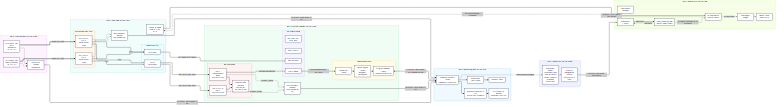
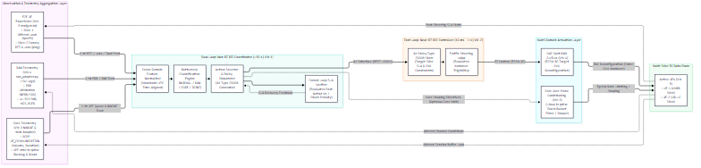

# System Architecture: O-RAN RIC–NWDAF Cross-Domain Platform

**Thesis Research Title:**  
*Bottleneck-Aware Closed-Loop Traffic Steering via O-RAN RIC–NWDAF Coordination in Multi-Slice 5G Networks*

This document provides the authoritative architectural specification for the 6-VM cross-domain experimental platform. The platform unifies O-RAN radio control loops with 5G Core user-plane analytics (3GPP NWDAF & Host Telemetry Adapters) to evaluate bottleneck diagnosis and adaptive traffic steering across multiple 5G network slices.

---

## 1. Architectural Principles & Scientific Scope

The architecture addresses the critical challenge of **domain myopia** in multi-slice 5G networks:
1. **The Domain Myopia Problem:**
   * **RAN Myopia:** When radio resources are congested, rerouting or modifying Core user-plane paths is ineffective.
   * **Core Myopia:** When Core UPF queues or transport links are saturated, triggering blind radio handovers between base station cells does not resolve the bottleneck and exacerbates ping-pong handover instability.
   * **Uncoordinated Decoupled Controllers:** When both domains experience simultaneous stress, independent uncoordinated controllers trigger conflicting actuations that destabilize slice SLAs.
2. **The Multi-Timescale Coordination Solution:**
   * **Slow-Loop Coordinator (~30 s):** Operates on the O-RAN Non-RT RIC (VM-1) using cross-domain feature aggregation and machine learning models to classify the root-cause bottleneck domain (`NORMAL`, `RAN`, `CORE`, `JOINT`).
   * **Fast-Loop Controller (10 ms – 1 s):** Operates on the Near-RT RIC (VM-2), executing fine-grained traffic steering via A1 policy constraints and E2 control.
   * **Closed-Loop SLA Verification:** Verifies post-action SLA compliance ($V_s$ and latency percentiles) to suppress action churn.

---

## 2. Testbed Topography & Network Demarcation

The platform is deployed entirely on dedicated virtual machines connected across an isolated private subnet: `10.102.0.0/24`. No physical SDR hardware or commercial UEs are required, ensuring complete academic reproducibility.

| Virtual Machine | Host IP Address | Functional Subsystem & Primary Services |
|---|---|---|
| **VM-1** (Non-RT RIC) | `10.102.0.168` | Non-RT RIC, A1 PMS v2.6.0 (`:8081`), rApp Host |
| **VM-2** (Near-RT RIC) | `10.102.0.66` | Near-RT RIC (Dawn), A1 Mediator (`:10001`), xApp Host |
| **VM-3** (5G Core & NWDAF) | `10.102.0.164` | OAI 5G Core Multi-Slice, 3GPP NWDAF (`:8080`), UPF Host |
| **VM-4** (Split RAN) | `10.102.0.167` | OAI Split RAN (CU-CP, CU-UP, DU-1, DU-2), E2 Agent |
| **VM-5** (nrUE Emulator) | `10.102.0.165` | OAI nrUE Emulator (netns: `ue1`, `ue2`), TrafGen |
| **VM-6** (Observability) | `10.102.0.67` | Telemetry Collector (`:9100`), Prometheus TSDB, Logger |

For complete software versions, Git commits, Docker image tags, and custom patches, refer to the [Software & Artifact Manifest](software-manifest.md).  
For the live operational status of each capability, see the [Implementation Status Matrix](implementation-status.md).

---

## 3. Current Implemented & Validated Architecture

The diagram below reflects the **empirically validated state** of the testbed currently operating in the laboratory:



### 3.1 Subsystem Demarcation

#### A. Radio Access Network Subsystem (VM-4)
* **CU-CP / CU-UP Split:** OAI native C softmodem (`nr-softmodem`) runs on VM-4, terminating RRC for control plane and SDAP/PDCP for user plane.
* **Dual Distributed Units (DU-1 & DU-2):**
  * **DU-1 (Cell-1, PCI 1):** Operates on RFsimulator TCP port `4043`. Default serving cell for Slice 1 (eMBB).
  * **DU-2 (Cell-2, PCI 2):** Operates on RFsimulator TCP port `4044`. Default serving cell for Slice 2 (URLLC).
* **RAN Telemetry Adapter (`ran_adapter.py`):**  
  A lightweight Python daemon that tails physical gNB scheduler logs (`du1.log` and `du2.log`), parsing instantaneous MAC allocation (`NPRB / 106`), UL-SCH SNR, MCS, and BLER, and transmitting JSON payloads to VM-6 (`POST :9100/report`) at 1.0 Hz.

#### B. 5G Core Network & NWDAF Subsystem (VM-3)
* **Control Plane Network Functions:** Containerized AMF, SMF-1 (eMBB), SMF-2 (URLLC), NRF-12, UDM, UDR, AUSF, and NSSF operating under 3GPP Release 16/17 SA specifications.
* **User Plane Functions (CUPS):**
  * **UPF-1 (`oai-upf-slice1`):** Dedicated anchor for Slice 1 (eMBB, S-NSSAI `01000001`, subnet `12.1.1.0/24`). Deploys the patched UPF `develop` image with native datapath URR support.
  * **UPF-2 (`oai-upf-slice2`):** Dedicated anchor for Slice 2 (URLLC, S-NSSAI `de00007b`, subnet `12.1.2.0/24`). Deploys the baseline `v2.1.0` image.
* **Native 3GPP NWDAF (AnLF):**  
  Deploys 8 microservices (`oai-nwdaf-nbi-gateway`, `oai-nwdaf-nbi-analytics`, `oai-nwdaf-nbi-events`, `oai-nwdaf-nbi-ml`, `oai-nwdaf-engine`, `oai-nwdaf-engine-ads`, `oai-nwdaf-sbi`, and MongoDB). It receives `QOS_MON` event exposure notifications from SMF-1, stores URR volume/duration records in MongoDB `qosmonlist`, and exposes `UE_COMMUNICATION` analytics via Kong Gateway at `http://10.102.0.164:8080/nnwdaf-analyticsinfo/v1/analytics`.
* **Core Telemetry Adapter (`core_adapter.py` v9):**  
  > [!IMPORTANT]
  > **Role Demarcation of `core_adapter.py`:**  
  > `core_adapter.py` is strictly a **read-only host telemetry scraper and exporter**. It executes on VM-3 to read physical Linux kernel egress queue backlogs (`tc -s qdisc show dev eth0`) and packet drops from UPF containers via Netlink, posting them at 1.0 Hz to VM-6 (`POST :9100/report`). It is **not** an actuator, **not** a 3GPP DCCF, and **not** an Nnwdaf SBI service.

#### C. User Equipment Emulator & Traffic Generator (VM-5)
* **Network Namespaces:** Linux network namespaces (`ue1` and `ue2`) isolate UE network stacks, routing tables, and dedicated virtual ethernet (`veth`) pairs.
* **nrUE Instances:**
  * **UE-1:** `IMSI: 208950000000001`, attached to Cell-1 (Port `4043`), obtaining IP `12.1.1.2` on interface `oaitun_ue1` inside namespace `ue1`.
  * **UE-2:** `IMSI: 208950000000002`, attached to Cell-2 (Port `4044`), obtaining IP `12.1.2.2` on interface `oaitun_ue1` inside namespace `ue2`.
* **Traffic Generator (`trafgen.sh`):** Emits continuous offered load on Slice 1 (`iperf3 -u -b 20M`) and sequence-tracked canary probes on Slice 2 (`ping -i 0.2 -s 64`), calculating latency RTT and sequence-matched packet loss.

#### D. Telemetry Ingestion & Monitoring Subsystem (VM-6)
* **Telemetry Collector (`telemetry_collector.py`):** Ingests asynchronous HTTP POST reports from `trafgen.sh`, `ran_adapter.py`, and `core_adapter.py`, while concurrently polling the NWDAF NBI API (`:8080`) over HTTP GET. Exposes consolidated gauges over Prometheus `:9100/metrics`.
* **Prometheus TSDB & Grafana:** Scrapes `:9100/metrics` at 1.0 Hz for live operator visualization.
* **Monotonic Dual-Stream Recorder (`record_dual_stream.py`):** Scrapes `:9100/metrics` at exactly 1.000 Hz using monotonic time, exporting the definitive 37-column CSV dataset (`telemetry_raw_<RUN>.csv`).

---

## 4. Proposed Closed-Loop Research Architecture

The diagram below illustrates the complete **proposed multi-timescale closed-loop control architecture** designed to resolve cross-domain bottlenecks:



### 4.1 Closed-Loop MAPE-K Control Cycle

1. **Monitor (Continuous Ingestion):**  
   The Non-RT RIC coordinator on VM-1 ingests normalized, time-aligned feature vectors streaming from the VM-6 telemetry pipeline at 1 Hz intervals.
2. **Analyze (Bottleneck Classification):**  
   The rApp executes an explainable classification engine (Decision Tree / Rules) to categorize system health into one of four states:
   * **`NORMAL`:** System operating within SLA bounds; no intervention required.
   * **`RAN_BOTTLENECK`:** Radio resource exhaustion (high PRB utilization, collapsed SNR/MCS, or elevated BLER), while Core queues remain empty.
   * **`CORE_BOTTLENECK`:** Transport queue accumulation (`upf_queue_backlog_bytes > 0`), surging packet drops, or elevated GTP delay, while radio PRBs remain available.
   * **`JOINT_BOTTLENECK`:** Simultaneous radio exhaustion and core transport queuing.
3. **Plan (Action Selection):**  
   * If `RAN_BOTTLENECK`: Dispatch A1 Policy Type 20008 to steer eligible traffic to the alternate cell (Cell-1 $\to$ Cell-2).
   * If `CORE_BOTTLENECK`: Restrict Core user-plane offered load or apply egress traffic shaping via UPF rate conditioning.
   * If `JOINT_BOTTLENECK`: Execute coordinated, staged mitigation (e.g., Core rate shaping first to stabilize buffers, followed by radio steering).
4. **Execute (Actuation):**  
   * **Near-RT RIC:** The xApp consumes A1 Policy Type 20008 and emits E2 Control messages (E2SM-RC) to OAI CU, triggering RRC Reconfiguration.
   * **Core Adapter:** Applies Linux `tc qdisc` Token Bucket Filter (TBF) constraints on target UPF egress interfaces.
5. **Verify (Closed-Loop SLA Recovery):**  
   The rApp evaluates post-steering SLA compliance ($V_s$, recovery time, and latency percentiles). If SLA is restored, further churn is suppressed; if the bottleneck persists, fallback mitigation is triggered.

---

## 5. End-to-End Packet & Telemetry Dataflow Summary

```text
========================================================================================================================
                                                MULTI-SLICE 5G DATA PATH
========================================================================================================================
 [ VM-5: nrUE ]               [ VM-4: Split RAN ]               [ VM-3: 5G Core ]               [ VM-3: Ext DN ]
  ue1 (eMBB)   ──► RFsim:4043 ──► DU-1 ──► F1-U ──► CU-UP ──► N3 ──► UPF-1 (eMBB)   ──► N6 ──► oai-ext-dn (:5201)
  ue2 (URLLC)  ──► RFsim:4044 ──► DU-2 ──► F1-U ──► CU-UP ──► N3 ──► UPF-2 (URLLC)  ──► N6 ──► oai-ext-dn (ICMP)

========================================================================================================================
                                             CROSS-DOMAIN TELEMETRY PATHS
========================================================================================================================
 Track 1: Native 3GPP Exposure
   UPF-1 (simpleswitch URR) ──► PFCP N4 (msg 56) ──► SMF-1 ──► QOS_MON ──► oai-nwdaf-sbi ──► MongoDB ──► Kong :8080

 Track 2: Core Host Adapter
   UPF-1 / UPF-2 Containers ──► Linux netlink / tc qdisc ──► core_adapter.py v9 ──► POST :9100/report (VM-6)

 Track 3: RAN Log Adapter
   DU-1 / DU-2 MAC Logs     ──► du1.log / du2.log        ──► ran_adapter.py    ──► POST :9100/report (VM-6)

 Track 4: UE Canary Probes
   netns ue1 / ue2          ──► iperf3 & ping canaries   ──► trafgen.sh        ──► POST :9100/report (VM-6)

 Aggregation & Storage (VM-6)
   telemetry_collector.py   ──► Prometheus (:9100/metrics) ──► record_dual_stream.py ──► telemetry_raw_<RUN>.csv
```

---

## 6. Document Map & Cross-References

* **Software Manifest:** [docs/software-manifest.md](software-manifest.md)
* **Implementation Status Matrix:** [docs/implementation-status.md](implementation-status.md)
* **Telemetry Metric Catalog:** [docs/telemetry/metric-catalog.md](telemetry/metric-catalog.md)
* **Deployment Guides:** [docs/deployment/README.md](deployment/README.md)
* **NWDAF Integration:** [docs/integration/nwdaf-integration.md](integration/nwdaf-integration.md)
* **A1 Integration:** [docs/integration/a1-integration.md](integration/a1-integration.md)
* **E2 Integration:** [docs/integration/e2-integration.md](integration/e2-integration.md)
* **Troubleshooting Cases:** [docs/troubleshooting/README.md](troubleshooting/README.md)
