# Experimental Evaluation Methodology & Baseline Framework

**Thesis Research Title:**  
*Bottleneck-Aware Closed-Loop Traffic Steering via O-RAN RIC–NWDAF Coordination in Multi-Slice 5G Networks*

---

## 1. Scientific Framework & Research Hypotheses

The central scientific question investigated in this research is whether **diagnosing the architectural domain of a network bottleneck (RAN vs. Core User Plane vs. Joint) prior to triggering control actions can reduce SLA violations ($V_s$), shorten recovery time ($T_{\text{rec}}$), and mitigate action churn ($C_{\text{act}}$)** compared to single-domain or decoupled control paradigms.

### 1.1 Research Hypotheses & Evaluation Questions
1. **$H_1$ (Dynamic Steering vs. Static Baseline):** Closed-loop dynamic steering is hypothesized to achieve lower SLA violation rates than static default slicing (B0) during radio degradation and core transport queuing.
2. **$H_2$ (Domain-Aware Action Selection):** Cross-domain coordination is hypothesized to achieve a lower wrong-domain actuation ratio ($W_{\text{act}}$) and reduce handover oscillation compared to single-domain RAN-only (B1) or Core-only (B2) controllers.
3. **$H_3$ (Multi-Timescale Coordination Stability):** Hierarchical coordination between a Non-RT RIC rApp (slow loop) and Near-RT RIC xApp (fast loop) is hypothesized to reduce conflicting control actions and action churn compared to uncoordinated, decoupled controllers (B3).

---

## 2. Comparative Baseline Matrix (B0 through B4 vs. Proposed)

To evaluate these hypotheses, the experimental testbed defines **five comparative baselines (B0 to B4)** alongside the **Proposed System**:

| Paradigm Tier | Baseline ID | Control Approach | Domain Awareness | Coordination Model |
|---|---|---|---|---|
| **Static Default** | **B0** | Standard 3GPP A3 Handover | Local Radio RSRP only | No RIC coordination |
| **Single-Domain** | **B1** & **B2** | Standalone xApp / Core Shaper | Isolated to RAN or Core | Single-domain visibility (RAN or Core only) |
| **Decoupled** | **B3** | Uncoordinated Dual Controllers | Both domains active | Independent uncoordinated actuation |
| **Fixed-Sequence Coordination** | **B4** | Fixed Priority Heuristic | Cross-domain aggregated | Static action sequence without root-cause diagnosis |
| **Proposed System** | **PROPOSED** | Closed-Loop MAPE-K Coordination | Cross-domain correlated | Root-cause matched steering & verification |

| Baseline ID | Control Paradigm | Decision Inputs | Actuation Mechanisms | Hypothesized Limitation / Evaluation Risk |
|---|---|---|---|---|
| **B0** | **Static 3GPP Baseline** | RSRP only (Standard A3 Event) | Autonomous gNB Handover | Operates without Core congestion visibility; does not provide dynamic slice traffic steering. |
| **B1** | **RAN-Only Control** | Radio scheduler metrics (PRB, SNR, MCS) | Inter-cell steering via Near-RT xApp | **Evaluated for Core-Blind Steering Risk:** Under Core UPF bottlenecks, risks executing unneeded inter-cell handovers or triggering handover churn without mitigating core queue saturation. |
| **B2** | **Core-Only Control** | Core telemetry (UPF queue, packet drops) | Linux `tc qdisc` rate shaping | **Evaluated for Radio-Blind Risk:** Cannot leverage alternative radio cells or radio scheduling adaptations when bottleneck originates in radio channel degradation. |
| **B3** | **Decoupled Controllers** | Both domains monitored independently | Independent xApp & Core adapters | **Evaluated for Actuation Conflict Risk:** Independent controllers risk issuing simultaneous, unaligned control actions without cross-domain arbitration, evaluated for potential SLA instability. |
| **B4** | **Fixed-Sequence Coordination** | Aggregated cross-domain telemetry | Fixed action sequence (e.g., Handover $\to$ Shape) | **Evaluated for Sequence Mismatch Risk:** Executes a predefined action sequence regardless of diagnosed root cause, evaluated for recovery delays when the initial action does not target the active bottleneck domain. |
| **PROPOSED** | **Bottleneck-Aware Closed-Loop** | Correlated RAN + Core Telemetry | Matched Action (RAN / Core / Joint) + SLA Verify | **Targeted Domain Matching & Stability Verification:** Selects actions matched to the diagnosed bottleneck domain (inter-cell radio steering for RAN, egress shaping for Core, or staged mitigation for Joint) and verifies SLA restoration over stability window $W_{\text{stab}}$ before admitting new actions. |

---

## 3. Dataset Partitioning, Temporal Run Separation, & Evaluation Integrity

### 3.1 Data Splitting Strategy Across Independent Runs
To ensure valid generalization without data leakage, experimental datasets must be partitioned strictly across **independent experiment runs/repetitions**, rather than randomly shuffling individual 1-second time rows:
* **Run-Level Partitioning:** Telemetry observations within an individual 180-second scenario execution are temporally autocorrelated. Random row-wise train/test splitting leaks past-state information into future predictions. Evaluation must split distinct complete execution runs:
  * **Training Set ($60\%$):** Independent experiment runs across all treatment regimes used for offline feature normalization and classifier training.
  * **Validation Set ($20\%$):** Distinct experiment runs used for hyperparameter tuning and decision threshold selection.
  * **Testing Set ($20\%$):** Fully unseen, independent experiment runs evaluated under continuous closed-loop execution.
* **Balanced Scenario Ordering:** To prevent time-of-day or hypervisor thermal accumulation bias, scenario execution order across repetitions must be varied or counterbalanced (e.g., Latin square ordering: Run 1 starts with S1, Run 2 starts with S3, Run 3 starts with S6).

### 3.2 Evaluation Integrity & Unbiased Benchmarking
* **No Artificial Benchmark Bias:** Experiments must **not** be designed to artificially penalize single-domain models or force fused cross-domain models to outperform them. If Core-only telemetry (`B2`) performs strongly on Core-isolated bottlenecks, this is documented as an authentic architectural characteristic, not an experimental flaw or "shortcut learning".
* **Full Logging without Automatic Eligibility Gates:** The telemetry recorder (`record_experiment.py`) records all observations continuously. There are no automatic training-eligibility gates or arbitrary row discards during collection. Data cleaning or filtering rules must be explicitly declared, justified, and evaluated for sensitivity during offline analysis.

### 3.3 Data Processing & Feature Engineering Rules
1. **Zero Artificial Imputation:** Unsupported metrics (such as `nwdaf_load_embb`) or unmeasured values emit strict **`NaN`**. They must **not** be filled with synthetic constants (e.g., $0$ or $-42\text{ dBm}$) during training.
2. **Monotonic Elapsed Timing:** Temporal feature alignment strictly uses `elapsed_sec` derived from `time.monotonic()` to eliminate leap-second or NTP wall-clock adjustments.
3. **Derivative vs. Cumulative Features:** Cumulative counters (`nwdaf_comm_ul_bytes`, `nwdaf_comm_dl_bytes`) update in step functions every $\approx 30\text{ s}$ governed by UPF periodic URR reports. Direct 1 Hz differentiation ($\Delta V / \Delta t$) yields zero-delta plateaus with 30-second burst spikes. For model evaluation, cumulative counters are either ingested directly as monotonic volume totals, or transformed using causal windowed averaging ($\frac{V_t - V_{t-W}}{W}$ where $W \ge 30\text{ s}$) with declared reset/epoch boundaries. Instantaneous 1 Hz differentiation must not be conflated with physical real-time line rate.
4. **Quality & Freshness Indicators (Not Deletion Filters):** Telemetry freshness indicators (`nwdaf_comm_freshness` at 45s and `e2e_probe_freshness` at 3.5s) function as telemetry health diagnostics, NOT blanket raw data validity masks. A value of `nwdaf_comm_freshness = 0` occurs legitimately during periods of stable zero-traffic or reporting stalls; recorder daemons strictly record all observations without row deletion. Downstream filtering, imputation, or masking policies are explicit analyst decisions that must be declared and tested for sensitivity during offline evaluation.

---

## 4. Evaluation Metrics & Statistical Validation

### 4.1 Unified SLA Evaluation Contract
To maintain consistency across all analysis and baseline evaluations, SLA satisfaction is defined per slice relative to workload demand:

1. **Slice 1 (eMBB) SLA Contract:**
   * **Offered Load vs. Receiver Goodput Demarcation:** In the recorded 40-column CSV dataset, `e2e_slice1_tput_mbps` strictly measures the client-side offered transmission rate ($T_{\text{offered}}$) generated by `iperf3 -u` at VM-5 (`ue1`). True eMBB user-plane goodput ($T_{\text{goodput}}$) is measured at the receiver endpoint (EXT-DN). In intervals where receiver-side logs (`/opt/oran/5gc/ext-dn/iperf_server.log`) are uningested, **eMBB goodput SLA cannot be conclusively evaluated** and is categorized as **`Unmeasured / Pending Receiver Evidence`**.
   * **Conditional Joint SLA & Recovery Scope:** Because eMBB goodput SLA evaluation is pending receiver log cross-validation, the evaluation of Joint SLA Violation Ratio ($V_{s,\text{joint}}$) and Two-Slice Recovery Time ($T_{\text{rec}}$) is conditional on the availability of verified receiver goodput evidence. When evaluations are restricted strictly to the streaming 40-column CSV, SLA evaluation is performed unambiguously on Slice 2 (URLLC), while eMBB compliance is reported as unmeasured goodput.
   * **SLA Threshold & Demarcation (When Receiver Data Available):**
     * **Historical Empirical Baseline:** Case 56 Phase 2 observed an average receiver goodput of $\approx 16.6\text{ Mbps}$ (with duration difference $\Delta t = 12.45\text{ s}$) under $20\text{ Mbps}$ offered load on 51 PRBs with `-E`, unity gain ($0.0\text{ dB}$), and pristine noise floor ($-100.0\text{ dB}$).
     * **Physical Capacity Pending Characterization:** The true physical channel capacity under the proposed calibrated reference noise floor (candidate grid $-40$ to $-20\text{ dB}$) and dynamic link adaptation is not yet finalized and will be formally characterized during upcoming capacity pilot sweeps.
     * **Research-Selected SLA Target Bound:** Under saturation stress (offered load $\ge 20\text{ Mbps}$), Slice 1 SLA evaluation adopts a candidate research target bound of receiver goodput $T_{\text{goodput}} \ge 16.0\text{ Mbps}$ (or $\ge 85\%$ of offered demand when operating below capacity). This value is an analytical research proposal for 51 PRB evaluation, distinct from the historical $\ge 20.0\text{ Mbps}$ SLA bound defined under the 106 PRB profile in `docs/references/standards.md`.
     * **Throughput vs. Latency Orthogonality:** Achieving $\ge 16.0\text{ Mbps}$ receiver goodput does not imply acceptable user delay. Transport queue accumulation, head-of-line buffering, and latency spikes can severely degrade service quality even while throughput nominally satisfies the threshold.
2. **Slice 2 (URLLC) SLA Contract:**
   * **End-to-End Latency Target:** Canary ICMP round-trip time $RTT \le 20.0\text{ ms}$ and sequence loss percentage $\le 1.0\%$.
   * **Scope & Standards Demarcation:** 3GPP TS 23.501 Table 5.7.4-1 defines standard Packet Delay Budget (PDB) as a delay bound across the **one-way UE–UPF segment terminating at the N6 reference point** according to specific standardized 5QI values (e.g., 5QI 82 = 10 ms, 5QI 83 = 10 ms, 5QI 84 = 30 ms, 5QI 85 = 5 ms for delay-critical GBR). Standard PDB is an endpoint-to-endpoint delay bound, distinct from end-to-end round-trip latency to an external Data Network (DN). In this testbed, the metric is **End-to-End ICMP RTT** measured between VM-5 namespace `ue2` and EXT-DN `192.168.70.145`. The $20.0\text{ ms}$ threshold is a research evaluation choice accounting for virtualization overhead, Linux network scheduling, and virtual RFsim socket loopbacks.

### 4.2 Quantitative Performance Metrics
1. **Window Evaluation States & Coverage:**
   * **`Compliant`:** Telemetry pipeline is healthy (`scrape_ok = 1`, `e2e_probe_freshness = 1`) and valid probe measurements satisfy the SLA bound ($RTT \le 20.0\text{ ms}$, loss $\le 1.0\%$).
   * **`Violated`:** Telemetry evidence confirms probe transmission but delivery failed or degraded (e.g., echo request sequence sent with observed loss $> 1.0\%$ or timeout, while scrape and collector pipeline remained operational with `scrape_ok = 1`).
   * **`Unknown / Unmeasured`:** Telemetry observation pipeline failed or probe evidence is absent (e.g., scrape failed `scrape_ok = 0`, collector daemon halted, or `rtt = NaN` without active sequence counter advancement).
   
   To maintain empirical rigor, every SLA evaluation must explicitly report **Measurement Coverage**:
   $$\text{Coverage}_i = \frac{K_{\text{measured},i}}{K_{\text{total}}} \times 100\%, \quad \text{where } K_{\text{measured},i} = K_{\text{compliant},i} + K_{\text{violated},i}$$
   Windows scored as `Unknown / Unmeasured` are excluded from the denominator $K_{\text{measured},i}$ rather than assumed compliant or penalized as outages.

2. **Per-Slice SLA Violation Ratio ($V_{s,i}$):**
   $$V_{s,\text{URLLC}} = \frac{K_{\text{violated},\text{URLLC}}}{K_{\text{measured},\text{URLLC}}} \times 100\%$$
   *(eMBB violation ratio $V_{s,\text{eMBB}}$ is reported when receiver-side goodput logs are available; otherwise designated as Unmeasured).*

3. **Joint SLA Violation Ratio ($V_{s,\text{joint}}$):**
   $$V_{s,\text{joint}} = \frac{1}{K_{\text{joint\_measured}}} \sum_{k=1}^{K_{\text{joint\_measured}}} \mathbb{I}\left(\text{SLA}_{\text{eMBB}}(k) = \text{Violated} \lor \text{SLA}_{\text{URLLC}}(k) = \text{Violated}\right) \times 100\%$$

4. **Wrong-Domain Action Ratio ($W_{\text{act}}$):**
   $$W_{\text{act}} = \frac{N_{\text{wrong}}}{N_{\text{total\_actions}}} \times 100\%$$
   Measures the proportion of dispatched control actions targeted at the incorrect domain (e.g., executing radio cell handover when the bottleneck resides in the UPF transport queue, or applying core shaping when the bottleneck is radio attenuation).

5. **Per-Window Policy Recall ($R_{\text{window}}$):**
   $$R_{\text{window}} = \frac{N_{\text{windows with correct intervention}}}{N_{\text{fault windows requiring intervention}}} \times 100\%$$
   Measures the proportion of fault windows requiring intervention that successfully receive a timely, correct-domain control action.

6. **SLA Recovery Time ($T_{\text{rec}}$):**
   $$T_{\text{rec}} = t_{\text{restored}} - t_{\text{violation}}$$
   Measured from the timestamp of first SLA violation onset ($t_{\text{violation}}$) following fault injection until slice SLAs return to compliance and remain continuously compliant for a **consecutive stability window of $W_{\text{stab}} \ge 10\text{ seconds}$**. Runs where SLA fails to recover within the experiment duration are explicitly recorded and reported as **Unrecovered** ($T_{\text{rec}} = \text{Unrecovered} \ (|T_{\text{exp}} - t_{\text{violation}}|)$), rather than omitted.

7. **Action Churn Rate ($C_{\text{act}}$):**
   The frequency of reversing or oscillating control actions (e.g., Cell-1 $\to$ Cell-2 $\to$ Cell-1) per observation epoch, disaggregated into Radio Handover Churn and Core Shaping Churn.

### 4.3 Statistical Significance Testing
All baseline comparisons are executed across a minimum of $N \ge 10$ independent random-seeded runs per scenario. Performance differences are evaluated using the non-parametric **Wilcoxon Signed-Rank Test** (paired) or **Mann-Whitney U Test** (independent) with a significance threshold of $\alpha = 0.05$.

---

## 5. Future Execution Methodology & Disturbance Calibration Framework

> [!NOTE]
> **Operational Status:**  
> The protocols and parameters in this section represent the **formal planned execution methodology** to be undertaken during the experimental phase. No runtime modifications, traffic generation, or fault injection are performed during this documentation release.

### 5.1 General Execution Lifecycle & Timing Cadence
Every experimental run follows an eight-stage lifecycle designed to capture clean pre-fault, active-fault, and post-fault recovery dynamics:

```mermaid
flowchart LR
    A["1. Baseline Reset\n(CLEAR / 0 dB / No TBF)"] --> B["2. Readback & Connectivity\n(Ping UE-1 & UE-2)"]
    B --> C["3. Workload Launch\n(Offered Load & Canary)"]
    C --> D["4. Treatment Application\n(RAN or Core Fault)"]
    D --> E["5. Settling Window\n(~60s proposed)"]
    E --> F["6. Telemetry Recording\n(~180s proposed)"]
    F --> G["7. Treatment Release\n(Clear Fault)"]
    G --> H["8. Recovery Observation\n(~60s+ proposed)"]
```



1. **Stage 1 — Baseline Reset:** Reset RF channel path loss to verified Profile 1 baseline ($0.0\text{ dB}$) and delete UPF egress rate shaping.
2. **Stage 2 — Readback & Connectivity Check:** Query RF channel status via `rfsim_channel_control.py show` and qdisc via `tc -s qdisc show dev eth0`. Confirm ping reachability from `ue1` and `ue2` to EXT-DN (`192.168.70.145`).
3. **Stage 3 — Workload Launch:** Start traffic generation (`iperf3 -u` on UE-1) and canary probing (`ping` on UE-2) with parameters explicitly logged in the experiment manifest.
4. **Stage 4 — Treatment Application:** Apply the specified scenario treatment (e.g., path loss attenuation via Telnet or egress TBF on UPF-1 container).
5. **Stage 5 — Settling Observation Window (~60s proposed):** Allow physical queues, scheduler link adaptation, and container network buffers to stabilize into the target operating regime.
6. **Stage 6 — Telemetry Recording Window (~180s proposed active disturbance):** Execute `record_experiment.py` at 1.000 Hz monotonic scraping cadence to capture the active disturbance regime.
7. **Stage 7 — Treatment Release:** Remove the active disturbance (restore radio attenuation or delete qdisc shaper).
8. **Stage 8 — Recovery Observation Window (~60s+ proposed):** Continue telemetry recording and canary probing until queue drainage, RTT normalization, and SLA recovery can be conclusively evaluated.

* **Recording Duration Spanning Recovery:**  
  Running `record_experiment.py` with `--duration 180` terminates the recorder immediately at $t = 180\text{ s}$, right when the treatment is released at Stage 7, capturing zero post-fault recovery telemetry. To record both the active disturbance regime (~180s) AND the post-fault recovery window (~60s+), the recorder must either be executed with a combined duration (e.g., `--duration 240` representing 180s active fault + 60s recovery), operated in manual stop mode (`--duration 0`) until recovery settles, or paired with a dedicated post-fault recovery recording.
* **Cross-VM Terminal Execution Separation:**  
  Operational procedures span multiple distinct VMs and must be executed in separate terminal sessions:
  * **Terminal 1 (VM-5 UE Traffic):** Runs `trafgen.sh start` in the foreground.
  * **Terminal 2 (VM-6 Monitoring / Recorder):** Runs `record_experiment.py` in the foreground.
  * **Terminal 3 (VM-4 RAN or VM-3 Core):** Executes fault injection at Stage 4 and fault release at Stage 7.
* **Operational Script Limitations & Gaps:**
  * **`trafgen.sh` Probe Cleanup Limitation:** In `scripts/trafgen.sh`, ping probe packet counts are hardcoded to $\approx \text{DURATION} + 5\text{ s}$. When the main duration loop finishes, `trafgen.sh` executes `cleanup()`, terminating ping processes immediately. Consequently, `trafgen.sh` alone does not maintain canary ping probing for 60 seconds after traffic stops unless ping is executed independently or trafgen duration is extended beyond traffic runtime.
  * **`rfsim_channel_control.py reset` Parameter Scope:** The `reset` subcommand in `scripts/rfsim_channel_control.py` resets only `path_loss_dB` (to $0.0\text{ dB}$ unity gain); it does **not** reset `noise_power_dB`.
* **Repetition Count:** An initial set of **3 independent repetitions** per scenario is planned for initial validation, expanding to $N \ge 10$ for final statistical testing.
* **NWDAF Ingestion Cadence Notice:** The Prometheus scraper operates at 1.0 Hz, but native upstream OAI NWDAF microservice updates depend on internal URR aggregation periods ($\approx 30\text{ s}$). A 1.0 Hz scrape rate captures new OAM and RAN adapter data every second, while NWDAF cumulative byte counters update in step-function intervals.

### 5.2 Scenario-Specific Methodological Rules
* **S1 & S2 (Normal Baseline Classification):**  
  The `BASELINE` label requires verified empirical confirmation that offered traffic is fully served without unserved queue growth or SLA degradation. The proposed candidate of $10\text{–}12\text{ Mbps}$ for S2 is an operating proposal; if future calibration shows queue accumulation at $12\text{ Mbps}$, the operating load must be adjusted downward to maintain clean baseline semantics.
* **S3 (Radio Overload via Capacity Saturation):**  
  Operating load must be determined via a dedicated capacity calibration pilot across candidate rates ($15, 18, 20\text{ Mbps}$). Once calibrated, a **single fixed load** is applied throughout the 180-second recording. Radio overload under clean channel conditions is characterized by scheduling queue growth and goodput shortfall; **BLER can remain low ($\approx 0\%$) and MCS high**, which must not be misconstrued as an absence of overload.
* **S4 (Radio Channel Degradation via Attenuation):**  
  The offered traffic load and reference noise power must remain strictly constant, while path attenuation on Channel 1 (`rfsimu_channel_ue0`) is adjusted. Target channel identity must be confirmed via Telnet readback. If severe attenuation triggers an unhandled softmodem assertion failure or crash, it must be recorded as an **infrastructure failure**, NOT as a valid training sample of radio congestion.
* **S6 (Core Bottleneck via UPF Egress Shaping):**  
  Radio channel capacity must be verified as capable of forwarding the offered load (e.g., $10\text{ Mbps}$ traffic), while the TBF rate on UPF-1 egress (`eth0`) is set strictly lower (candidate $5\text{–}6\text{ Mbps}$) so that the constraint binds at the Core user plane. The formal terminology is **UPF-host/container egress shaping**.
* **S9 (Joint Bottleneck Binding Condition):**  
  Because Uplink data traverses the radio access link before reaching the UPF, the UPF egress TBF rate must be configured **strictly below the arrival rate forwarded by the degraded radio channel** ($R_{\text{TBF}} < R_{\text{arr}}$). If the radio channel throttles traffic to $7\text{ Mbps}$, an egress TBF of $12\text{ Mbps}$ will not bind, resulting in an empty UPF queue that fails to demonstrate joint congestion.
* **S10 (Staged Recovery Sequences & Dynamic Labeling):**  
  Two counterbalanced recovery sequences are evaluated:
  1. Sequence A: $\text{JOINT} \xrightarrow{\text{Restore Radio}} \text{CORE} \xrightarrow{\text{Release TBF}} \text{BASELINE}$.
  2. Sequence B: $\text{JOINT} \xrightarrow{\text{Release TBF}} \text{RAN} \xrightarrow{\text{Restore Radio}} \text{BASELINE}$.
  Each phase is allocated approximately 120 seconds. The physical transition timestamp must be recorded separately from the subsequent time of full service recovery. **A single static class label must never be assigned to the entire multi-phase recording.**

---

### 5.3 Physical Foundation of Thermal Noise
In wireless communications, the theoretical thermal noise power floor at standard reference temperature ($T_0 \approx 290\text{ K}$) across an effective noise bandwidth $B$ is given by Johnson-Nyquist relation:

$$N = k_B \cdot T_0 \cdot B$$

where $k_B \approx 1.380649 \times 10^{-23}\text{ J/K}$ is Boltzmann's constant. Expressed in logarithmic units ($\text{dBm}$):

$$N_{\text{dBm}} \approx -174 + 10\log_{10}(B_{\text{Hz}}) + NF_{\text{dB}}$$

* **20 MHz Carrier Calculation (Example):**
  For a nominal channel bandwidth of $20\text{ MHz}$ ($B = 20 \times 10^6\text{ Hz}$):
  $$10\log_{10}(20 \times 10^6) \approx 73.01\text{ dB}$$
  $$N_{\text{thermal}} \approx -174 + 73.01 = -100.99\text{ dBm} \approx -101\text{ dBm}$$
  If an illustrative receiver Noise Figure of $NF = 5\text{ dB}$ is assumed:
  $$N_{\text{total}} \approx -101\text{ dBm} + 5\text{ dB} = -96\text{ dBm}$$
* **Methodological Boundaries & Disclaimers:**
  1. **Noise Bandwidth Definition:** The noise bandwidth must be explicitly defined (e.g., $20\text{ MHz}$ nominal vs. $18.36\text{ MHz}$ active subcarrier transmission bandwidth for 51 PRBs).
  2. **Illustrative Assumption:** $NF = 5\text{ dB}$ represents a standard illustrative engineering assumption for 5G NR FR1 receivers per 3GPP TR 38.817-02 v15.11.0, not a proprietary or measured hardware constant of the host server.
  3. **No Direct Copying to Simulator:** Physical thermal noise power in $\text{dBm}$ **cannot be copied directly** into OAI RFSimulator's `noise_power_dB` configuration parameter, which operates under an internal normalized mathematical scaling model.
  4. **Attribution Boundary:** Calculations are derived from fundamental physical principles and 3GPP technical reports; they must not be attributed to specific regulatory bodies or commercial operators without explicit supporting documentation.

---

### 5.4 OAI Implementation Reference (Commit `29d5fa7d`)
Inspection of the OpenAirInterface codebase at testbed reference commit [`29d5fa7d`](https://github.com/OPENAIRINTERFACE/openairinterface5g/tree/29d5fa7d38bb1ee8935ef7ae30a396d53772ea4f), specifically `radio/rfsimulator/apply_channelmod.c` (line 225) and `openair1/SIMULATION/TOOLS/DOC/channel_simulation.md`, reveals the exact mathematical application of gain and noise:

1. **Signal Amplitude Scaling:**
   $$\text{amplitude\_multiplier} = 10^{\frac{\text{path\_loss\_dB}}{20.0}}$$
   In `apply_channelmod.c`, signal scaling multiplies I/Q baseband samples by `amplitude_multiplier`. A configured value of $\text{path\_loss\_dB} = 0.0$ yields unity gain ($1.0\times$).
2. **Noise Generation & Scaling (Actual Code Implementation):**
   In `radio/rfsimulator/apply_channelmod.c` line 225, the per-sample noise amplitude is calculated as:
   ```c
   const double noise_per_sample = pow(10, channelDesc->noise_power_dB / 10.0) * 256;
   ```
   Expressed mathematically:
   $$\text{noise\_per\_sample} = 256 \cdot 10^{\frac{\text{noise\_power\_dB}}{10.0}}$$
   > [!IMPORTANT]
   > Notice that the exponent divisor is **`10.0`** (power-scale decibel conversion) rather than `20.0`, and the result is scaled by a digital baseband factor of **`256`**. This actual OAI implementation must not be substituted with common voltage-ratio formulas ($10^{\text{dB}/20}$).

   In function `rxAddInput()`, this scaling is applied to the pseudo-random normal generator:
   ```c
   // Executed per sample for real and imaginary components
   out_ptr->r += ... + noise_per_sample * gaussZiggurat(0.0, 1.0);
   out_ptr->i += ... + noise_per_sample * gaussZiggurat(0.0, 1.0);
   ```
   `gaussZiggurat(0.0, 1.0)` generates a pseudo-random standard normal variable with mean $\mu = 0$ and unit variance $\sigma^2 = 1.0$.
3. **Exact Standard Deviation of Injected Digital Noise:**
   Because `gaussZiggurat(0.0, 1.0)` has unit standard deviation, the effective standard deviation of the additive noise per I/Q sample is $\sigma_{\text{noise}} = \text{noise\_per\_sample} = 256 \cdot 10^{\frac{\text{noise\_power\_dB}}{10.0}}$:
   * **At `noise_power_dB = -100.0 dB`:**
     $$\sigma_{\text{noise}} = 256 \cdot 10^{-10} = 2.56 \times 10^{-8}$$
     Injected noise is negligible relative to baseband digital integers, creating an effectively pristine channel.
   * **At `noise_power_dB = -40.0 dB`:**
     $$\sigma_{\text{noise}} = 256 \cdot 10^{-4} = 0.0256$$
   * **At `noise_power_dB = -30.0 dB`:**
     $$\sigma_{\text{noise}} = 256 \cdot 10^{-3} = 0.256$$
   * **At `noise_power_dB = -20.0 dB`:**
     $$\sigma_{\text{noise}} = 256 \cdot 10^{-2} = 2.56$$
   * **At Historical `noise_power_dB = -2.0 dB` (Early Case 51 Trials):**
     $$\sigma_{\text{noise}} = 256 \cdot 10^{-0.2} \approx 256 \times 0.63096 \approx 161.5$$
     This explains why `noise_power_dB = -2.0` in early trials caused massive signal corruption and link collapse unless countered by artificial $+20\text{ dB}$ signal amplification.

---

### 5.5 Stepwise Noise Calibration Plan *(Planned Procedure)*
To establish a stable reference noise level that allows realistic radio link adaptation without inducing software clock dilation, the following calibration protocol is defined for upcoming execution:

1. **Fixed Baseline Controls:** Maintain DU-1 at Profile 1 (51 PRBs, SCS 30 kHz, `-E`, $23.04\text{ Msps}$), unity gain $\text{ploss\_dB} = 0.0$, and fixed offered traffic load ($\approx 10\text{ Mbps}$).
2. **Documented Baseline Anchor:** Utilize `noise_power_dB = -100.0` as the established reference comparator where SFN progress is verified at $1.05\times - 1.09\times$ and link adaptation operates near optimum.
3. **Proposed Candidate Evaluation Grid:** Evaluate stepwise candidate values in ascending order of noise injection:
   $$\text{Candidate Grid: } \{-40.0\text{ dB}, -30.0\text{ dB}, -25.0\text{ dB}, -20.0\text{ dB}\}$$
4. **Execution Audit Checklist per Candidate:**
   * **Parameter Verification:** Confirm via softmodem telnet (`show`) that `noise_power_dB` is active.
   * **SFN Clock Progression:** Execute `measure_sfn_clock.py` as an operational screening check to verify that the clock ratio remains $\ge 0.95\times$ (a practical screening heuristic to ensure absence of severe software clock dilation, rather than definitive proof of zero CPU contention).
   * **Session Continuity:** Monitor `/opt/oran/ran/du1.log` and UE logs to ensure absence of RRC disconnects, assertion crashes, or tun interface teardowns.
   * **Telemetry Response:** Check `ran_adapter.py` readouts for observable SNR headroom and adaptive MCS response.
5. **Selection Criteria for Reference Noise:** The candidate providing observable link adaptation dynamic range while maintaining real-time SFN progress ($\ge 0.95\times$) and 0% RRC drops will be chosen as the reference noise floor.  
   *(Clarification on Baseline Semantics: Non-zero BLER or wide MCS fluctuations are NOT strict prerequisites for a valid baseline. A baseline operating cleanly with low or zero BLER is fully legitimate. Radio link variations and degradation are primarily evaluated under treatment S4 via path attenuation).*
6. **Consistent Application:** The calibrated reference noise floor will be held strictly uniform across all operational scenarios (S1, S2, S3, S4, S6, S9, S10).
7. **Decoupled Attenuation in S4:** Under scenario S4, the reference noise floor is maintained constant, and radio degradation is injected exclusively by varying path attenuation.

> [!WARNING]
> The candidate values ($-40, -30, -25, -20\text{ dB}$) are internal engineering proposals, NOT standard thresholds. **No final value is selected at this stage, and none of the candidates are claimed as validated.**

---

### 5.6 Comprehensive Evidence Requirements & Interpretation Boundaries
To ensure empirical reproducibility, the following artifacts must be captured for every experiment run:
* **Telemetry CSV:** Complete 40-column time series generated by `record_experiment.py` at 1.000 Hz cadence.
* **iPerf Client & Server Logs:** Complete sender-side logs from VM-5 and receiver-side logs (`receiver_<SESSION_ID>.json`) from EXT-DN, including per-second interval reports.
* **Canary Latency Traces:** ICMP ping logs for UE-1 and UE-2 covering the pre-fault, active disturbance, and post-fault recovery window.
* **Service & System Logs:** Softmodem logs (`cu.log`, `du1.log`, `du2.log`), Linux kernel dmesg, and Docker container logs.
* **Readback Verification Logs:** Timestamped outputs from `rfsim_channel_control.py show` and `tc -s qdisc show dev eth0`.
* **SFN Audit Logs:** Output log from `measure_sfn_clock.py` documenting frame advance ratio against monotonic wall-clock time.

**Interpretation Boundaries & Analytical Rules:**
1. **Offered Throughput vs. Arrival Goodput:** Sender throughput (`e2e_slice1_tput_mbps`) measures injection rate, distinct from delivered goodput at the receiver.
2. **Transient vs. Permanent Packet Loss:** A 1-second ICMP `no answer yet` reflects transient buffering latency, not permanent air-interface packet loss.
3. **Queue Localization:** iPerf duration differences ($\Delta t$) verify session volume accounting consistency, but do not localize whether queues reside in socket buffers, RLC entities, or UPF qdiscs.
4. **Instantaneous Grant vs. Integrated PRB Usage:** `ran_prb_cell1` is a proxy for instantaneous PUSCH scheduling grant per TTI, distinct from time–frequency integrated cell utilization per 3GPP TS 38.314.
5. **Low BLER Under Overload:** Capacity exhaustion under clean channel conditions naturally exhibits low BLER and high MCS; overload is evidenced by queue accumulation and goodput deficits.
6. **Slice 2 Generalizability:** Canary performance on Slice 2 validates slice isolation strictly under the tested traffic and channel conditions.
7. **Single-Domain Diagnostic Validity:** Strong performance by Core-only models under Core bottlenecks is a legitimate domain characteristic and must not be treated as experimental error.

---

## 6. Testbed Execution Timing & RFSimulator Channel Modeling Specification

### 6.1 Computational Bottleneck Analysis in Source Code
Inspection of OAI source code (commit [`29d5fa7d`](https://github.com/OPENAIRINTERFACE/openairinterface5g/tree/29d5fa7d38bb1ee8935ef7ae30a396d53772ea4f), file `radio/rfsimulator/apply_channelmod.c` at `rxAddInput()`):
```c
// Invoked 2x per I/Q sample across all subcarriers and antenna ports
out_ptr->r += ... + noise_per_sample * gaussZiggurat(0.0, 1.0);
out_ptr->i += ... + noise_per_sample * gaussZiggurat(0.0, 1.0);
```
Even with unity gain (`ploss_dB = 0.0`) and low noise floor (`noise_power_dB = -100.0`), `gaussZiggurat(0.0, 1.0)` executes per-sample floating-point random generation and channel matrix convolutions. At 106 PRBs full sampling ($61.44\text{ Msps}$), this generates over **$122.8\text{ million}$** random number calls per second on a single thread (`ru_thread`), inducing severe CPU saturation that dilates the simulated radio clock to $\approx 0.42\times - 0.44\times$ real-time ([Case 55](../troubleshooting/ran-ue.md#case-55)).

**Empirical SFN Radio Clock Verification Instrument:**
To quantitatively detect and audit execution speed dilation, the testbed utilizes the Python audit utility [`scripts/measure_sfn_clock.py`](../../scripts/measure_sfn_clock.py). Operating on VM-4 (`oai-ran`), the tool tails DU scheduler frame announcements (`Frame.Slot <N>.0`):
$$\text{SFN Ratio} = \frac{\Delta T_{\text{radio}}}{\Delta T_{\text{wall}}} = \frac{\Delta \text{Frame} \times 0.010\text{ s}}{\Delta t_{\text{monotonic}}}$$
Per 3GPP TS 38.211 §4.3.1, one NR frame is exactly $10\text{ ms}$. A ratio $\approx 1.0\times$ confirms unhindered real-time emulation, while a ratio $< 0.8\times$ reveals simulator-induced CPU stalling.

---

### 6.2 3GPP Bandwidth Mapping & Three-Quarter Sampling (`-E`)
To relieve simulator computational dilation while preserving active channel modeling, the testbed evaluates 3GPP bandwidth downscaling paired with OAI Three-Quarter Sampling (`-E`):

1. **Frequency Domain Processing & FFT Sizing:**
   OFDM signals are processed in the frequency domain via Fast Fourier Transform (FFT). Standard Cooley-Tukey FFT architectures require transform sizes of power-of-two ($2^N$). Standard 3GPP transmission bandwidth configurations (3GPP TS 38.104 Table 5.3.2-1), however, rarely align with power-of-two boundaries:
   * **106 PRBs ($40\text{ MHz}$, SCS $30\text{ kHz}$):** $106 \times 12 = 1272\text{ active subcarriers}$. The next power-of-two FFT is **2048 points** ($61.44\text{ Msps}$), leaving $2048 - 1272 = 776$ unused guard-band subcarriers that the CPU is forced to compute.
   * **Three-Quarter Sampling (`-E`):** OAI implements an alternative sampling rate using $\frac{3}{4} \times 2^N$. For 106 PRBs, FFT size scales to $\frac{3}{4} \times 2048 = 1536\text{ points}$ ($46.08\text{ Msps}$). Because $1536 \ge 1272$, all 106 PRBs are accommodated without frequency truncation, reducing computational load by $25\%$.
   * **51 PRBs ($20\text{ MHz}$, SCS $30\text{ kHz}$):** $51 \times 12 = 612\text{ active subcarriers}$. The power-of-two size is 1024. With `-E`, the transform size reduces to:
     $$\text{FFT} = 1024 \times \frac{3}{4} = 768\text{ points} \quad (23.04\text{ Msps})$$
     Because $768 \ge 612$, all 51 PRBs fit completely without spectral distortion, reducing computational sample volume by **$62.5\%$** relative to unscaled 106 PRBs.

2. **Source Code Implementation in OpenAirInterface (Commit `29d5fa7d`):**
   * **CLI Parameter Declaration (`executables/softmodem-common.h` line 141):**
     ```c
     {"E", CONFIG_HLP_TQFS, PARAMFLAG_BOOL, .iptr=&softmodem_params.threequarter_fs, .defintval=0, TYPE_INT, 0},
     ```
   * **UE Frame Config Propagation (`executables/nr-uesoftmodem.c` line 242):**
     ```c
     fp->threequarter_fs = get_softmodem_params()->threequarter_fs;
     ```
   * **Transform Sizing Logic (`openair1/PHY/INIT/nr_parms.c` lines 97–116):**
     ```c
     fp->ofdm_symbol_size = 512;
     while(fp->ofdm_symbol_size < N_RB_DL * NR_NB_SC_PER_RB)
         fp->ofdm_symbol_size <<= 1;

     if (fp->threequarter_fs) {
         const uint16_t threeq_fft_size = fp->ofdm_symbol_size * 3 / 4;
         if (threeq_fft_size < (N_RB_DL * NR_NB_SC_PER_RB)) {
             warn_higher_threequarter_fs(N_RB_DL, fp->numerology_index);
             fp->ofdm_symbol_size = threeq_fft_size << 1;
         } else {
             fp->ofdm_symbol_size = threeq_fft_size;
         }
     }
     ```
   * **Sampling Rate Mapping (`common/utils/nr/nr_common.c` lines 895–901 in `get_samplerate_and_bw()`):**
     ```c
     case 51:
       if (threequarter_fs) {
         *sample_rate = 23040000;
         *tx_bw = 20e6;
         *rx_bw = 20e6;
       }
     ```
   * **SSB Carrier Scan for 51 PRBs (`--ue-scan-carrier`):**
     In carrier bandwidths of 51 PRBs ($612$ subcarriers), the hardcoded default SSB subcarrier offset assumed by `nr-uesoftmodem` (516 subcarriers, tailored for 106 PRBs) falls outside the carrier bandwidth ($516 + 240 = 756 > 612$), causing initial synchronization failure (`synch Failed`). Passing `--ue-scan-carrier` enables dynamic carrier scanning via `get_scan_ssb_first_sc()` (`openair1/PHY/NR_UE_TRANSPORT/nr_initial_sync.c`), allowing the UE to scan GSCN raster candidates (e.g. GSCN 7923 at $3610.56\text{ MHz}$) and resolve the subcarrier offset `ssbFirstSC` dynamically, achieving initial synchronization in 1 frame.

---

### 6.3 Comprehensive Comparison: 106 PRBs vs. 51 PRBs Across Evaluated Profiles
To provide an authoritative decision matrix for testbed operators and researchers, the table below consolidates the empirical findings across all four evaluated testbed configurations:

| Evaluation Metric | Configuration 1: Historical Dilation Benchmark (106 PRB + `chanmod`, no `-E`) | Configuration 2: Transition Option A (106 PRB + `-E` + `chanmod`) | Configuration 3: Wire-Speed Baseline (106 PRB, no `chanmod`, no `-E`) | Configuration 4: Calibrated Profile 1 (51 PRB + `-E` + `chanmod` — Recommended) |
|---|---|---|---|---|
| **Nominal Bandwidth** | $40\text{ MHz}$ (Band n78, SCS $30\text{ kHz}$) | $40\text{ MHz}$ (Band n78, SCS $30\text{ kHz}$) | $40\text{ MHz}$ (Band n78, SCS $30\text{ kHz}$) | **$20\text{ MHz}$** (Band n78, SCS $30\text{ kHz}$) |
| **Allocated PRBs** | $106\text{ PRBs}$ ($1272\text{ subcarriers}$) | $106\text{ PRBs}$ ($1272\text{ subcarriers}$) | $106\text{ PRBs}$ ($1272\text{ subcarriers}$) | **$51\text{ PRBs}$** ($612\text{ subcarriers}$) |
| **Sampling Rate & FFT**| $61.44\text{ Msps}$ (FFT 2048) | $46.08\text{ Msps}$ (FFT 1536) | $61.44\text{ Msps}$ (FFT 2048) | **$23.04\text{ Msps}$ (FFT 768)** |
| **Channel Simulation** | Active (`ploss=0.0`, `noise=-100.0`) | Active (`ploss=0.0`, `noise=-100.0`) | **Disabled (`options = ();`)** | **Active (`ploss=0.0`, `noise=-100.0`)** |
| **SFN Radio Clock Ratio**| $\mathbf{0.42\times - 0.44\times}$ (Severe Dilation) | $\mathbf{0.57\times - 0.58\times}$ (Partial Dilation) | $\mathbf{1.02\times}$ (Near Real-Time) | $\mathbf{1.05\times - 1.09\times}$ (**Near Real-Time**) |
| **Computational Dilation Relief**| Severe Dilation Constraint | Partial Relief ($+31.8\%$ speedup) | Dilation Free | Substantially Relieved (No large lag) |
| **Receiver Throughput @ 20M**| $\approx 12.9 - 13.1\text{ Mbps}$ (Dilation Absorption Cap)| $\approx 17.1\text{ Mbps}$ ($+31.5\%$) | **$20.0\text{ Mbps}$** (Line-Rate Delivery)| **$16.6\text{ Mbps}$** (Session Average Measured)|
| **Receiver–Sender Duration Difference ($\Delta t$)**| $\mathbf{+10.54\text{ s}}$ (Simulator Bufferbloat)| $\mathbf{+3.37\text{ s}}$ (Reduced Backlog) | $\mathbf{+0.03\text{ s}}$ (Nominal difference) | $\mathbf{+0.05\text{ s}}$ ($\le 15\text{M}$); $\mathbf{+12.45\text{ s}}$ (@ 20M session)|
| **Telemetry Dynamics** | Link adaptation active under RF test | Link adaptation active under RF test | **Unperturbed** (ideal channel, minimal link adaptation)| Link adaptation active under RF test |
| **Empirical Case Link** | [Case 55 (Gejala)](../troubleshooting/ran-ue.md#case-55) | [Case 56 (Phase 1)](../troubleshooting/ran-ue.md#case-56) | [Case 55 (Solusi)](../troubleshooting/ran-ue.md#case-55) & [Case 53](../troubleshooting/ran-ue.md#case-53) | [Case 56 (Phase 2)](../troubleshooting/ran-ue.md#case-56) |

*(Note on Historical Profiles: Configuration 1 corresponds to Profile 3A evaluated at `ploss_dB = 0.0, noise_power_dB = -100.0` demonstrating dilation. Profile 3B represents early RF fault injection trials evaluated at elevated noise `noise_power_dB = -2.0` in Case 51).*

---

### 6.4 Researcher Decision Guide: Choosing Between 106 PRBs and 51 PRBs
Based on empirical characterization, researchers can select the operational profile tailored to their experimental goal:

1. **Choose 51 PRBs with `-E` and Active `chanmod` (Configuration 4 — Recommended Default):**
   * **Target Use Case:** Machine Learning model training, NWDAF AnLF bottleneck detection, Near-RT RIC xApp closed-loop steering, and cross-domain root-cause analysis (RCA).
   * **Expected Behavior:** Radio progress runs near real-time ($1.05\times - 1.09\times$). Offered loads at 5, 10, and 15 Mbps complete with a nominal duration difference ($\approx +0.05\text{ s}$). Offered load at 20 Mbps results in an average measured receiver throughput of $16.6\text{ Mbps}$ with a receiver–sender duration difference ($\Delta t$) of $12.45\text{ s}$. Radio link adaptation mechanisms remain available for dynamic RF impairment sweeps.
2. **Choose 106 PRBs without `chanmod` (Configuration 3 — Wire-Speed Baseline):**
   * **Target Use Case:** Core network user-plane benchmarking, UPF queue queuing/drop characterization under extreme throughput, or evaluating maximum line-rate saturation (20.0+ Mbps).
   * **Expected Behavior:** Line-rate delivery ($20.0\text{ Mbps}$, $20.03\text{ s}$ duration, 0% packet loss) and near real-time execution ($1.02\times$). Radio link metrics remain unperturbed.
3. **Avoid 106 PRBs with `chanmod` (Configuration 1 & Configuration 2):**
   * **Observed Limitation:** Without downscaling, per-sample Gaussian convolutions in `apply_channelmod.c` saturate single-core CPU throughput, dilating radio progress to $0.44\times$ (full sampling) or $0.58\times$ (with `-E`).
   * **Experimental Risk:** Wall-clock packet intake is artificially capped at $\approx 13\text{ Mbps}$ (or $17\text{ Mbps}$), generating severe secondary bufferbloat and false latency spikes that corrupt time-series training data.

---

### 6.5 Multi-Step Empirical Load Characterization under Profile 1 (60-second test runs)

| Offered Load (UDP) | SFN Clock Ratio | Receiver Throughput | Packet Loss | Duration Delta | Mean RTT (Slice 2 Co-run) | Status |
|---|---|---|---|---|---|---|
| **5.0 Mbps** | $1.09\times$ (Near Real-time) | **$5.00\text{ Mbps}$** | **0.0%** (0/25,897) | $+0.05\text{ s}$ | $18.9\text{ ms}$ | Healthy Normal |
| **10.0 Mbps** | $1.08\times$ (Near Real-time) | **$9.99\text{ Mbps}$** | **0.0%** (0/51,795) | $+0.05\text{ s}$ | $17.4\text{ ms}$ | Healthy Normal |
| **15.0 Mbps** | $1.06\times$ (Near Real-time) | **$15.0\text{ Mbps}$** | **0.0%** (0/77,694) | $+0.05\text{ s}$ | $15.1\text{ ms}$ | Healthy Normal |
| **20.0 Mbps** | $1.05\times$ (Near Real-time) | **$16.6\text{ Mbps}$** (Measured Avg)| **0.0%** (0/103,592)| $+12.45\text{ s}$ ($\Delta t$) | $20.2\text{ ms}$ | High Load Session |

---

### 6.6 Analysis of 20 Mbps Session Timing and Duration Difference ($\Delta t$)
Under Profile 1 (51 PRBs + `-E`), transmitting 20.0 Mbps UDP load over 60 seconds resulted in an average receiver throughput of $16.56\text{ Mbps}$ ($16.6\text{ Mbps}$ rounded) over an active receiver duration of $72.45\text{ s}$ (a duration delta of $+12.45\text{ s}$ relative to sender).

**Algebraic Relation vs. Queue Validation:**
The relationship between sender offered rate $R_{\text{tx}}$, sender duration $T_{\text{tx}}$, receiver throughput $G_{\text{rx}}$, and receiver duration delta $\Delta t = T_{\text{rx}} - T_{\text{tx}}$ is expressed algebraically as:
$$\Delta t = \frac{(R_{\text{tx}} - G_{\text{rx}}) \times T_{\text{tx}}}{G_{\text{rx}}} = \frac{(20.0 - 16.563) \times 60.0}{16.563} \approx 12.45\text{ seconds}$$
This formulation confirms algebraic consistency between the total volume of delivered bits and the reported reporting duration across the session. It serves as an accounting check for delivered data rather than an independent validation of exact queue location (e.g. socket send buffer vs. RLC entity vs. receiver socket).

**Channel Parameterization Context:**
Per 3GPP TS 38.214, physical PUSCH maximum data rate depends on detailed transmission parameters including allocated PRBs ($51$), OFDM symbols per slot, DMRS pattern and overhead, modulation order (e.g. 64QAM), target coding rate, and TDD DL/UL slot allocation ratio (2 UL slots per 5 ms period). Under this testbed configuration, 16.6 Mbps represents the **empirically measured average receiver throughput under 20 Mbps offered load**, providing a stable operating reference for multi-slice evaluation.
