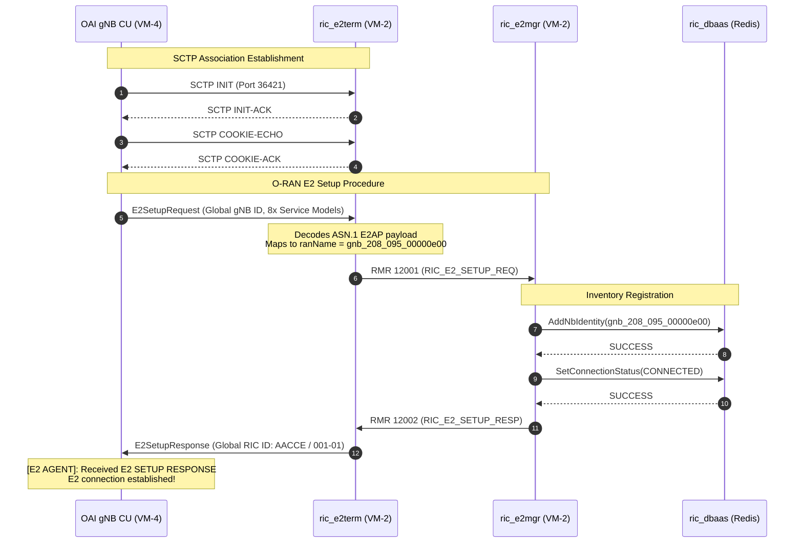

# E2 Integration — OAI RAN to Near-RT RIC

This document describes the validated **O-RAN E2 integration path between VM-4 (`oai-ran`) and VM-2 (`near-rt-ric`)**.

The goal of this integration is to enable near-real-time telemetry and closed-loop radio control between the OpenAirInterface 5G RAN and the O-RAN Software Community (O-RAN SC) Near-RT RIC, providing the fundamental measurement and actuation path for the thesis's **QoS-aware traffic steering xApp**.

The validated end-to-end E2 path is:

```text
┌────────────────────────────────────────────────────────┐
│ VM-4 OAI RAN (10.102.0.167)                             │
│   ├── gNB Centralized Unit (CU)                        │
│   │     └── Integrated FlexRIC E2 Agent                │
│   │           ├── E2SM-KPM (ID: 2)                     │
│   │           ├── E2SM-RC  (ID: 3)                     │
│   │           └── 6x FlexRIC Layer 2 Service Models    │
│   └── 2x Distributed Units (DU-1 / DU-2)               │
└───────────────────────────┬────────────────────────────┘
                            │
                            │ E2AP over SCTP (Port 36421)
                            ▼
┌────────────────────────────────────────────────────────┐
│ VM-2 Near-RT RIC (10.102.0.66)                         │
│   ├── ric_e2term (SCTP termination & ASN.1 codec)      │
│   │     │                                              │
│   │     │ RMR (Msg Type 12001: E2_SETUP_REQ)           │
│   │     ▼                                              │
│   ├── ric_e2mgr (NodeB inventory & state machine)      │
│   │     │                                              │
│   │     ├── Shared Data Layer (SDL)                    │
│   │     │     ▼                                        │
│   │     └── ric_dbaas (Redis 5.0.9 / RNIB inventory)   │
│   │                                                    │
│   └── ric_submgr & python_xapp_runner                  │
└────────────────────────────────────────────────────────┘
```

---

## 1. Components & Endpoints

| Component | VM | IP / Interface | Role in E2 Path |
|---|---|---|---|
| OAI gNB CU E2 Agent | VM-4 | `10.102.0.167` | Generates E2SetupRequest, encodes E2SM telemetry, executes E2SM-RC control. |
| `ric_e2term` | VM-2 | `10.102.0.66:36421/SCTP` | Terminates E2 SCTP association, decodes ASN.1 E2AP, forwards via RMR. |
| `ric_e2mgr` | VM-2 | `10.0.2.11:3800` (HTTP) | Manages NodeB lifecycle, validates E2Setup, updates RNIB database. |
| `ric_dbaas` | VM-2 | `10.0.2.12:6379` (Redis) | Radio Network Information Base (RNIB) storing NodeB identities and SMs. |
| `ric_submgr` | VM-2 | `10.0.2.13` | Coordinates xApp E2 subscriptions to RAN nodes. |
| `python_xapp_runner`| VM-2 | `10.0.2.20:4560` (RMR) | Execution container for traffic steering xApp subscribing to KPM/RC. |

Validated software versions:

| Component | Version / Tag | Repository / Image |
|---|---|---|
| OAI 5G RAN | `develop` (pinned) | `OPENAIRINTERFACE/openairinterface5g` |
| FlexRIC E2 Agent | `develop` submodule | `gitlab.eurecom.fr/mosaic5g/flexric.git` |
| O-RAN SC E2Term | `6.0.4` | `nexus3.o-ran-sc.org:10002/o-ran-sc/ric-plt-e2:6.0.4` |
| O-RAN SC E2Mgr | `6.0.4` | `nexus3.o-ran-sc.org:10002/o-ran-sc/ric-plt-e2mgr:6.0.4` |
| O-RAN SC DBaaS | `0.5.7` (Redis 5.0.9) | `nexus3.o-ran-sc.org:10002/o-ran-sc/ric-plt-dbaas:0.5.7` |
| E2AP Specification | `v02.03` | O-RAN Alliance Working Group 3 (WG3) |

---

## 2. Theoretical & Standardization Rationale for E2 Architecture

### 2.1 Why E2 Is Essential for the Thesis
In our multi-timescale architecture:
1. **A1 Interface** provides declarative, non-real-time ($> 1\text{ s}$) policy guidance from the rApp to the xApp (e.g. latency SLA limits for Slice 2, high PRB utilization trigger thresholds).
2. **E2 Interface** provides near-real-time ($10\text{ ms} - 1\text{ s}$) closed-loop interaction between the xApp and the physical radio nodes:
   - **Telemetry (*Sensor*):** Without E2SM-KPM, the xApp cannot observe cell PRB utilization, per-slice active UE counts, or channel CQI/RSRP.
   - **Actuation (*Hand*):** Without E2SM-RC, the xApp cannot instruct the CU/DU to execute handovers or adjust slice PRB quotas.
   
Therefore, **both A1 and E2 are strictly mandatory** to satisfy the thesis research scope.

### 2.2 Global gNodeB Identity Formation
- **Standard:** **3GPP TS 38.413** and **O-RAN.WG3.E2AP-v02.03**.
- **Calculation:** The E2 Node ID is formed by concatenating the PLMN identity (`MCC 208, MNC 95`) with the 22-to-32 bit gNB ID (`0xe00` = decimal `3584`).
- **Resulting Name:**
  ```text
  gnb_208_095_00000e00
  ```
- In the Near-RT RIC RNIB inventory, the PLMN is stored as hex `02F859` (BCD-encoded per 3GPP TS 29.571: MCC 208, MNC 95 with two-digit fill `F`), and `nbId` is stored as `00000e00`.

### 2.3 E2 Service Models (E2SM)
The compiled and installed Service Models on VM-4 (`/usr/local/lib/flexric/`) provide the function definitions used by Near-RT RIC xApps:

| Service Model | ID | Version | Role in Thesis Experiment |
|---|---|---|---|
| **E2SM-KPM** | `2` | `v02.03` | Key Performance Measurement: periodic reporting of slice PRB utilization and UE throughput. |
| **E2SM-RC** | `3` | `v01.03` | RAN Control: triggers handover and traffic steering decisions issued by the xApp. |
| **E2SM-SLICE** | `145` | FlexRIC | Dynamic slice resource allocation, quota enforcement, and slice scheduling configuration. |
| **E2SM-MAC** | `142` | FlexRIC | MAC layer transport block statistics and buffer occupancy monitoring. |
| **E2SM-RLC** | `143` | FlexRIC | RLC PDU counters and packet retransmission telemetry. |
| **E2SM-PDCP** | `144` | FlexRIC | PDCP sequence numbering, packet delay, and volume metrics per DRB. |
| **E2SM-TC** | `146` | FlexRIC | Traffic Conditioning for policy-enforced rate shaping. |
| **E2SM-GTP** | `148` | FlexRIC | GTP-U tunnel byte counts and N3 user plane telemetry. |

### 2.4 DBaaS Redis Protocol Alignment (RESP2 vs RESP3)
- **Technical Issue:** O-RAN SC `ric-plt-e2mgr:6.0.4` is written in Go and uses `go-redis` v6 / `libsdl-go`. When connecting to Redis 6.2+ or 7 (`latest`), `go-redis` queries `COMMAND` to discover server metadata. Redis 6.2+ expanded the `COMMAND` response from 6 elements to 7 elements (introducing ACL category metadata). This caused E2Mgr to panic and crash immediately upon startup:
  ```text
  panic: redis: got 7 elements in COMMAND reply, wanted 6
  ```
- **Solution:** `DBAAS_VER=0.5.7` is pinned, which runs **Redis 5.0.9-alpine**. Redis 5.0.9 returns exactly 6 elements for `COMMAND`, preserving strict protocol compatibility with E2Mgr while retaining the custom O-RAN Shared Data Layer module (`libredismodule.so`).

### 2.5 E2Manager Keepalive Timeout Tuning
- **Technical Issue:** In `ric/configs/e2mgr.yaml`, `keepAliveResponseTimeoutMs` is set by default to `4500` ms (4.5 seconds). If E2Term does not respond to keepalive pings within 4.5 seconds (common in static multi-VM testbeds without Kubernetes service routing), E2Manager triggers an automated shutdown:
  ```text
  DELETE /ric/v1/handles/e2t
  ```
  Once the E2T instance is deleted, E2Manager drops any incoming `E2SetupRequest` from the RAN.
- **Solution:** Setting `keepAliveResponseTimeoutMs: 3600000` (1 hour) and `keepAliveDelayMs: 3600000` stabilizes the E2T instance permanently, ensuring that incoming E2 setup requests from VM-4 are immediately processed.

---

## 3. Parameter Customization Reference Guide

| Parameter | Current Value | Classification | Customization Rules & Impact |
|---|---|---|---|
| `near_ric_ip_addr` | `10.102.0.66` | `[CUSTOMIZABLE]` | VM-2 IP where `ric_e2term` port 36421 is reachable from VM-4. |
| `gNB_ID` | `0xe00` (3584) | `[CUSTOMIZABLE]` | gNodeB identifier. Affects RAN name `gnb_208_095_00000e00`. |
| `sm_dir` | `/usr/local/lib/flexric/` | `[FIXED / ARCHITECTURE]` | Path where compiled `*_sm.so` plugins are installed on VM-4. |
| `E2TERM_SCTP_PORT` | `36421` | `[FIXED / ARCHITECTURE]` | O-RAN standard E2AP SCTP port exposed on VM-2 host. |
| `DBAAS_VER` | `0.5.7` | `[FIXED / ARCHITECTURE]` | Must remain `0.5.7` (Redis 5.0.9) to prevent RESP2 panic. |
| `E2MGR_HTTP_PORT` | `3800` | `[FIXED / ARCHITECTURE]` | Internal/REST port for querying NodeB status and E2T inventory. |
| `keepAliveResponseTimeoutMs`| `3600000` | `[FIXED / ARCHITECTURE]` | Relaxed timeout to prevent automated E2T deletion. |
| `loglevel` | `4` (debug) | `[CUSTOMIZABLE]` | Verbosity of E2Mgr (`4`) and E2Term (`debug`). |

---

## 4. E2 Setup Message Flow



---

## 5. Configuration Details

### 5.1 VM-4 Centralized Unit (`/opt/oran/ran/conf/cu_gnb.conf`)
The E2 Agent configuration block embedded in the CU configuration:

```hcl
# [MANDATORY MATCH RIC] O-RAN E2 Agent Configuration
e2_agent = {
  near_ric_ip_addr = "10.102.0.66";              # [CUSTOMIZABLE] Near-RT RIC IP
  sm_dir = "/usr/local/lib/flexric/";            # [FIXED] Location of compiled Service Models
};
```

### 5.2 VM-2 Near-RT RIC Docker Compose (`/opt/oran/nearrt/oran-sc-ric/docker-compose.yml`)
Exposing port `36421` over SCTP:

```yaml
  e2term:
    image: nexus3.o-ran-sc.org:10002/o-ran-sc/ric-plt-e2:6.0.4
    container_name: ric_e2term
    ports:
      - "36421:36421/sctp"
    environment:
      - DBAAS_SERVICE_HOST=${DBAAS_IP}
      - DBAAS_SERVICE_PORT=${DBAAS_PORT}
```

### 5.3 VM-2 E2Manager Configuration (`/opt/oran/nearrt/oran-sc-ric/ric/configs/e2mgr.yaml`)
Stabilized keepalive settings:

```yaml
loglevel: 4
http:
  port: 3800
rmr:
  port: 3801
  maxMsgSize: 65536
keepAliveResponseTimeoutMs: 3600000
keepAliveDelayMs: 3600000
e2tInstanceDeletionTimeoutMs: 3600000
```

---

## 6. Acceptance Criteria & Live Verification Outputs

All verification steps have been executed and verified live on the testbed:

### Step 1: Verify E2Term Decodes ASN.1 from gNB CU
On VM-2 (`near-rt-ric`):
```bash
sudo docker logs ric_e2term --tail 25
```
**Verified Output:**
```text
duid =-1
ranName =gnb_208_095_00000e00
gNB_CU_UP_ID and gNB_DU_ID is null
cuupid =-1
duid =-1
ranName =gnb_208_095_00000e00
```

### Step 2: Verify E2Manager Registers NodeB Identity
On VM-2 (`near-rt-ric`):
```bash
sudo docker logs ric_e2mgr --tail 25
```
**Verified Output:**
```text
{"ts":1790484709842,"crit":"INFO","id":"e2mgr","msg":"#ranListManagerInstance.AddNbIdentity - RAN name: gnb_208_095_00000e00 - Successfully added nodeb identity"}
{"ts":1790484709842,"crit":"DEBUG","id":"e2mgr","msg":"#ranListManagerInstance.AddNbIdentity - nodeb Identity map: map[gnb_208_095_00000e00:inventory_name:\"gnb_208_095_00000e00\"  global_nb_id:{plmn_id:\"02F859\"  nb_id:\"00000e00\"}  connection_status:CONNECTED]"}
{"ts":1790484709843,"crit":"INFO","id":"e2mgr","msg":"#RanConnectStatusChangeManager.ChangeStatus - RAN name: gnb_208_095_00000e00, currentStatus: UNKNOWN_CONNECTION_STATUS, nextStatus: CONNECTED"}
{"ts":1790484709843,"crit":"INFO","id":"e2mgr","msg":"#RmrSender.Send - RAN name: gnb_208_095_00000e00 , Message type: 12002 - Successfully sent RMR message"}
```

### Step 3: Query E2T Inventory via E2Mgr REST API
On VM-2 (`near-rt-ric`):
```bash
curl -s http://10.0.2.11:3800/v1/e2t/list | jq .
```
**Verified Output:**
```json
[
  {
    "e2tAddress": "10.0.2.10:38000",
    "ranNames": [
      "gnb_208_095_00000e00"
    ]
  }
]
```

### Step 4: Query NodeB Details via E2Mgr REST API
On VM-2 (`near-rt-ric`):
```bash
curl -s http://10.0.2.11:3800/v1/nodeb/gnb_208_095_00000e00 | jq .
```
**Verified Output:**
```json
{
  "connectionStatus": "CONNECTED",
  "globalNbId": {
    "nbId": "00000e00",
    "plmnId": "02F859"
  },
  "ip": "10.102.0.167",
  "nodeType": "GNB",
  "port": 36421,
  "ranName": "gnb_208_095_00000e00"
}
```

---

## 7. Status Demarcation & Next Stage: xApp E2 Subscriptions

To maintain strict scientific and evidence-based boundaries across the O-RAN E2 control plane:
1. **E2 Setup Handshake (`Validated`):** CU FlexRIC Agent association, SCTP transport (`:36421`), and RNIB registration (`gnb_208_095_00000e00`) are fully verified on the testbed.
2. **Telemetry Ingestion Architecture Decision:** In earlier standalone prototypes, direct `E2SM-KPM` indications were tested. For the active 40-column dataset pipeline, radio scheduler metrics are parsed directly from DU execution logs via `ran_adapter.py` and forwarded over HTTP to the centralized collector (`telemetry_collector.py`) on VM-6, independent of E2SM-KPM subscription lifecycle or RMR message routing. Collector-side aggregation receives asynchronous adapter reports and polls NWDAF separately; temporal alignment and report completeness are monitored via recorded timestamps and scraper health indicators (`scrape_ok`), rather than assuming deterministic synchronization across distinct network paths. Any comparative claims regarding RMR message loss under stress would require dedicated benchmarking evidence.
3. **E2SM-RC Control Actuation (`Planned Phase B`):** Autonomous traffic steering via E2 Control requests (E2SM-RC, Service Model ID: 3) instructing OAI CU to execute inter-cell handover (Cell-1 $\leftrightarrow$ Cell-2) is designed and documented as a planned research protocol for Phase B. Handover actuation has not yet been executed in live dataset runs on this testbed; current operational baselines (B0 and B1) observe traffic and contention dynamics without triggering active radio handovers.

---

## References
- O-RAN WG3: E2 Application Protocol (E2AP) v02.03
- O-RAN WG3: E2 Service Model — Key Performance Measurement (E2SM-KPM) v02.03
- O-RAN WG3: E2 Service Model — RAN Control (E2SM-RC) v01.03
- OpenAirInterface FlexRIC Documentation: https://gitlab.eurecom.fr/mosaic5g/flexric
- O-RAN SC E2 Manager Documentation: https://docs.o-ran-sc.org/projects/o-ran-sc-ric-plt-e2mgr
- O-RAN SC E2 Termination Documentation: https://docs.o-ran-sc.org/projects/o-ran-sc-ric-plt-e2

---

## Related Documentation

- [VM-4 — OAI RAN](../deployment/vm-04-ran.md)
- [VM-2 — Near-RT RIC](../deployment/vm-02-near-rt-ric.md)
- [A1 Integration Guide](a1-integration.md)
- [System Architecture](../architecture.md)
- [Troubleshooting](../troubleshooting/README.md)
